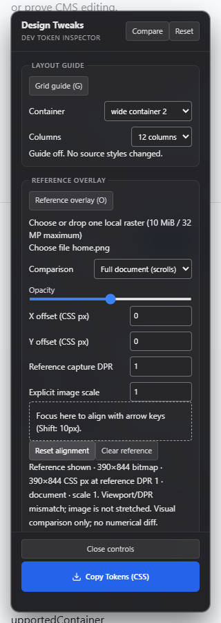
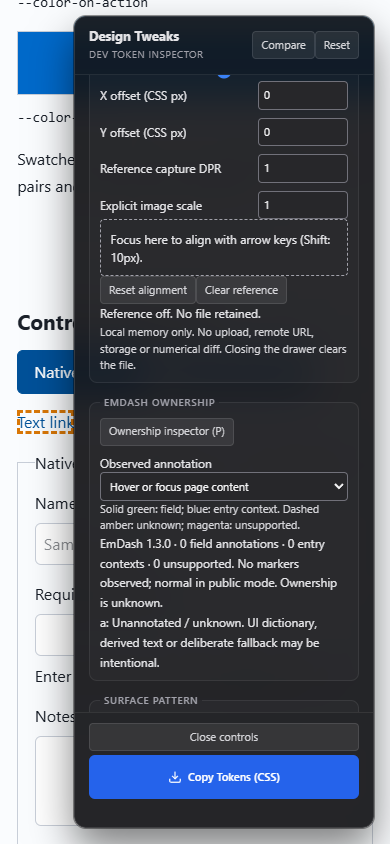
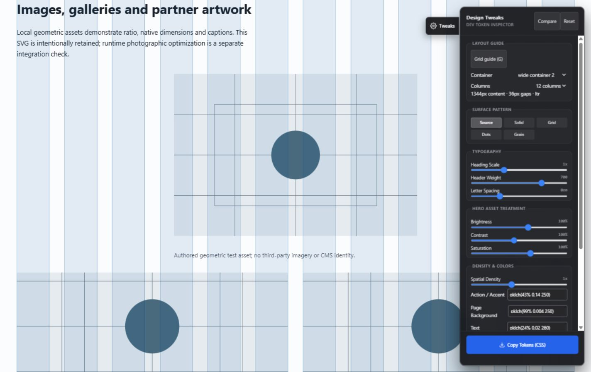
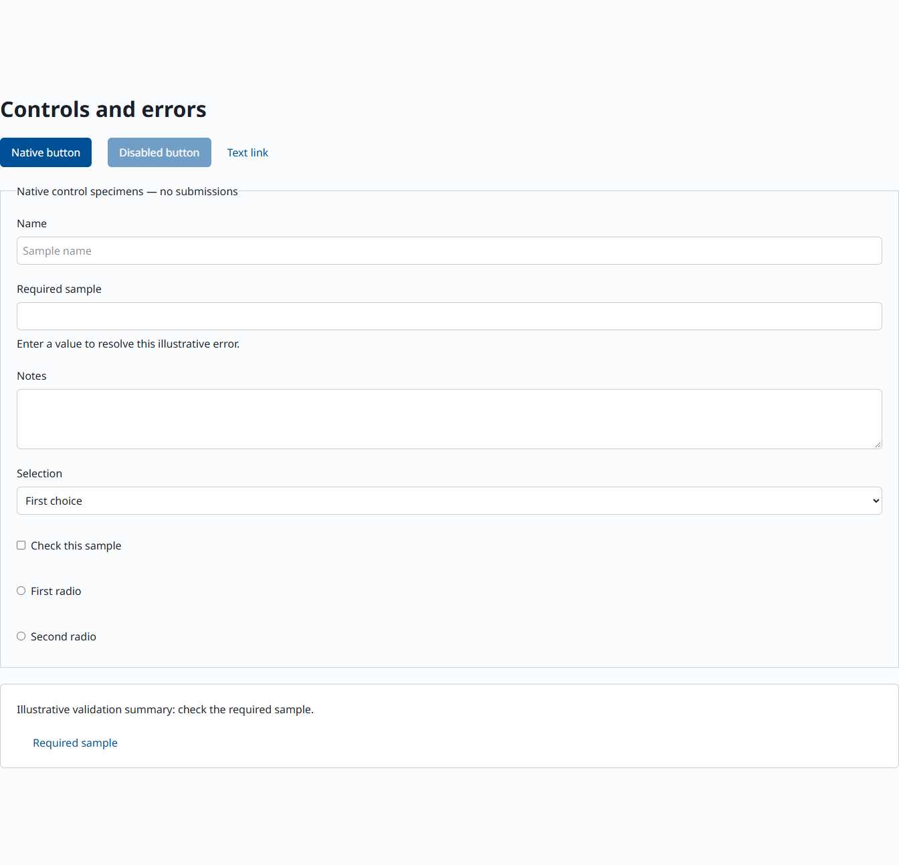

# Baseline — The Visual-First Astro Toolkit for EmDash CMS & AI-Assisted Developers

[](https://astro.build/)
[](https://docs.emdashcms.com/)
[](https://tailwindcss.com/)
[](#60-second-quickstart)
[](LICENSE)

EmDash is a modern, lightweight headless CMS built ground-up for AI-native web development. Baseline provides the visual frontend foundation, development guardrails, and testing harness built specifically for developers pairing with AI coding assistants (Claude Code, Antigravity, Cursor).

Spend your time building the site, not debugging agent hallucinations or wrestling with styling drift. Baseline gives your AI assistant clear architectural boundaries and provides you with in-browser visual inspection tools: tune design tokens live on the rendered page, align Figma mockups pixel-for-pixel, and stress-test reusable components in isolation before assembling templates. Start locally with Node and SQLite, catch schema-width problems early, and deploy with confidence.

## Why Baseline?

### ⚡ Tune the page, skip the guesswork — `T` / `B`

Stop bouncing between Figma, CSS edits and browser refreshes to find the right spacing. Adjust fluid typography scales, letter tracking, spatial density and OKLCH palettes directly in the browser. Press **B** to A/B compare with your source CSS, then copy the changed tokens in one click. The export separates Tailwind `@theme` tokens from ordinary `:root` properties; merge it into your stylesheet and reload to verify the result.

### 🎯 Bring the mockup into the browser — `O`

Choose or drop a local screenshot or exported Figma mockup onto the overlay controls. Tune opacity, CSS-pixel offsets, capture DPR and scale; switch between scrolling full-page and fixed-viewport comparisons. Align details without leaving the dev server. References stay in memory, with no uploads or persistent storage. The overlay helps you judge alignment; it does not claim an automated pixel-perfect result.

### 📐 See the real layout tracks — `G`

Overlay the selected container's actual bounds and 10/12-column diagnostic tracks. Check gutters and alignment as the viewport changes, without adding temporary CSS borders or rebuilding a grid in your design tool.

### 🔍 Make CMS ownership visible — `P`

Spot observed EmDash field annotations, entry context and unannotated text before handoff. Use that map to investigate editorial wiring early. Missing markers mean **unknown**, not automatically hardcoded or broken; actual editing and saving still need a real editor check.

### 🛡️ Catch wide schemas before they reach production

Local SQLite can accept models that exceed Cloudflare D1's [100-column table limit](https://developers.cloudflare.com/d1/platform/limits/). Baseline's automatic `check:schema-budget` preflight measures physical collection columns, including generated and retained legacy columns, against a conservative **50-column budget** before build/typecheck. Catch this class of failure earlier; a missing database is reported as not measured. Full D1/R2 parity tooling remains on the roadmap.

### 🧪 Fix components once, before building twenty pages

Open **`/_styleguide`** to calibrate components, controls, galleries and responsive stress cases in isolation. Stage 4.5 component quarantine makes shared problems visible before page assembly multiplies them. Normal production builds return **404** for the route and exclude the development HUD; explicit test fixtures use a separate build profile.

### 🚀 Ship less JavaScript

`LogoTicker` renders on the server and animates with CSS: **0 KB of component client JavaScript**, a native pause toggle, reduced-motion fallback and RTL support. Use trusted, noninteractive logo items; linked or editor-owned partners belong in an unduplicated list. Native Astro images and progressively enhanced galleries round out the reusable primitives.

### 📸 Catch regressions locally, keep CI lean

Compare mobile, tablet and desktop captures with pinned Windows Chromium. Exercise active motion, no-JS rendering, zoom and text spacing alongside screenshot diffs. No paid visual-testing SaaS or Docker setup is required, and browser tests consume **no GitHub Actions minutes**: they run locally, outside production builds and deployments. Baseline changes require an explicit, reviewed `--update`.

### 🤖 Keep AI coding assistants disciplined and on rails

Building client sites with tools like Claude Code, Cursor, or Antigravity is fast, but coding assistants often struggle with headless CMS architectures. Without clear constraints, they tend to invent unnecessary wrapper components, hardcode text that clients should be able to edit in the CMS, or introduce subtle layout breaks on mobile viewports.

Baseline includes a structured workflow designed to keep coding assistants disciplined and aligned with the site's architecture:

- **Art direction gates before implementation:** Before writing visual code, the agent is directed to record aesthetic decisions in `AGENTS.md` (typography pairings, spatial density, and anti-patterns). This prevents the assistant from defaulting to generic, unconsidered layouts.
- **CMS editorial preservation:** Guidance in `.agents/skills/` explicitly defines EmDash's row-per-locale structure and field-proxy attributes (`data-emdash-ref`). The agent knows which content belongs to the CMS and avoids overwriting client-editable fields with static copy.
- **Component quarantine (`/_styleguide`):** Instead of attempting to build ten full page templates at once, the workflow directs the agent to calibrate reusable primitives and responsive edge cases in isolation on `/_styleguide` first.
- **Fast, self-verifying feedback loops:** The agent has access to deterministic local checks that run in seconds, allowing it to verify its own work without guessing:
  - `npm run check:schema-budget` prevents table designs that will break on Cloudflare D1.
  - `npm run test:visual` verifies that CSS refactors haven't broken mobile or RTL layouts.
  - Fast unit tests and typechecking run locally without burning CI minutes.
- **Maintainable specialist skills:** Guidance is modularized into specialist skills under `.agents/skills/` (content modeling, visual design, and migration) that can be kept up to date from upstream via `npm run sync:site-skills` without overwriting project-specific instructions. [Agent setup guide](docs/agent-documentation.md).

## In-browser visual developer tools

Click any thumbnail to view the full-resolution screenshot.

| <a href="docs/images/reference-overlay.png"></a> | <a href="docs/images/ownership-inspector.png"></a> |
| :--- | :--- |
| **Mockup Overlay (`O`)**<br>Drop a Figma export or screenshot directly into the running browser. Tune opacity, CSS-pixel offsets, and scrolling modes to align spacing pixel-for-pixel without leaving the dev server. | **CMS Ownership Inspector (`P`)**<br>Inspect which page elements are bound to EmDash fields (green) versus hardcoded UI copy (amber). Catches missing editorial bindings before client handoff. |

| <a href="docs/images/grid-guide.jpg"></a> | <a href="docs/images/styleguide.jpg"></a> |
| :--- | :--- |
| **Container Grid Guide (`G`)**<br>Overlay real container bounds, padding, and 10/12-column responsive layout tracks over your live page to check alignment across viewports without adding CSS borders. | **Component Quarantine (`/_styleguide`)**<br>Calibrate components, galleries, and responsive stress-cases in isolation before building templates. Automatically returns 404 in production builds. |

## Dev HUD cheat sheet

| Key | What it saves you doing by hand |
| --- | --- |
| **T** | Open token controls and tune the rendered page |
| **B** | Compare temporary tweaks with the source baseline |
| **G** | Measure container bounds, gutters and column alignment |
| **O** | Align a local reference without switching applications |
| **P** | Find observed CMS ownership annotations for inspection |

Open the drawer before using G/O/P. Shortcuts yield to inputs and editor dialogs; Escape dismisses the active tool before closing the drawer. Changes start without overrides and do not persist across reloads. [Full HUD guide](docs/dev-hud.md).

## 60-second quickstart

**Node 22.22.2 minimum; Node 24 LTS recommended.** Use npm and the checked-in lockfile. Run these commands to begin; install and first-build time depend on your machine.

```sh
git clone https://github.com/Vermeulen-Solutions/emdash-baseline.git my-site
cd my-site
npm install
npx emdash secrets generate --write .env
npm run dev
```

Open the URL printed by Astro, then visit **`/_emdash/admin`** to complete setup and create your administrator account. There are no shared default credentials. Keep `.env`, databases, uploads and encryption-key backups private.

Before adapting a site, rename the package, read [AGENTS.md](AGENTS.md), review [staged skill updates](docs/skill-synchronization.md), and follow [new-site-workflow](.agents/skills/new-site-workflow/SKILL.md). Replace sample content and record the site's actual brief and art direction.

### Starting a site with an AI assistant

When pairing with Claude Code, Antigravity, or Cursor on this repo, prompt your assistant:
> *"Read AGENTS.md, follow new-site-workflow under .agents/skills/, and record the site's Art Direction Record before implementing templates."*

To connect your coding assistant directly to EmDash's built-in Model Context Protocol (MCP) server for managing content and schema, generate a token in one step:
```sh
npm run mcp:token
```
See [agent documentation](docs/agent-documentation.md) for Cursor, Claude Code, and Antigravity MCP setup.

## How EmDash & Astro connect

EmDash stores your structured content in local SQLite; Astro renders your server-rendered pages. Binding an entry's data and visual editing proxies takes only a few lines in your `.astro` template:

```astro
---
import Base from '../layouts/Base.astro';

// 1. Receive or query the content entry
const { entry } = Astro.props;
---

<!-- 2. Pass collection identity to Base layout for live editing overlay -->
<Base title={entry.data.title} content={{ collection: 'pages', id: entry.data.id, slug: entry.data.slug }}>
  <!-- 3. Spread field proxies so clients can edit visually in EmDash -->
  <h1 {...(entry.edit.title || {})}>{entry.data.title}</h1>
  <p {...(entry.edit.excerpt || {})}>{entry.data.excerpt}</p>
</Base>
```

See [editorial canvas guide](docs/emdash-editorial-canvas.md) for full field proxy and schema budget rules.

## Where to work (project layout)

| Path | Purpose |
| --- | --- |
| `src/pages/` | Server-rendered public routes (`/`, `/about`, `/posts/[slug]`, `/_styleguide`) |
| `src/layouts/Base.astro` | Core layout shell, EmDash live-editing script, and header/footer |
| `src/components/` | Reusable layout primitives (`Section`, `Container`, `Grid`, `Card`, `LogoTicker`) |
| `src/styles/global.css` | Neutral Tailwind v4 `@theme` tokens, typography, and base rules |
| `seed/seed.json` | Initial Posts/Pages schema and starter content |
| `src/live.config.ts` | EmDash live collection registration |
| `astro.config.mjs` | Astro configuration (Node adapter, EmDash SQLite setup, Tailwind v4) |
| `.agents/skills/` | Modular specialist skills for AI coding agents |
| `docs/` | Complete documentation guides (see [docs/README.md](docs/README.md)) |

## Daily commands

| Command | Use it for |
| --- | --- |
| `npm run dev` | Develop the site and open `/_styleguide` |
| `npm run typecheck` | Astro/TypeScript diagnostics and schema preflight |
| `npm run check:schema-budget` | Measure the local database's physical collection widths |
| `node --test tests/*.test.mjs` | Run the unit and tooling tests |
| `npm run test:visual` | Compare local Windows captures with reviewed baselines |
| `npm run test:dev-hud` | Exercise HUD alignment, ownership and keyboard behavior |
| `npm run check:dev-tools` | Verify development tools stay out of production |
| `npm run build` | Build the Node production artifact |
| `npm run start:local` | Run that artifact with your local `.env` |
| `npm run audit:site -- --root ../my-site` | Diagnose a downstream repository without changing it |
| `npm run check:upstream` | Review Astro, adapters, EmDash and Node version updates |

Browser tests need the exact renderer described in [visual regression setup](docs/visual-regression.md). CI uses one Node version for fast checks and a normal build; screenshot comparisons remain local.

## Build with content, not around it

Use the neutral Tailwind v4 tokens and small `Section`, `Container` and `Grid` primitives as your starting API. Keep editorial content in EmDash, forward field attributes to the stored value being rendered, and verify save/reload before handoff. Put site imagery in `src/assets/` or EmDash Media Library so native processing and ownership stay clear.

[Component quarantine](.agents/skills/astro-site-design/references/component-quarantine.md) · [Editorial canvas](docs/emdash-editorial-canvas.md) · [Gallery workflow](docs/gallery-workflow.md) · [Image delivery](docs/image-delivery.md).

The default runtime is **Node + SQLite + local media**, with no cloud account needed. Cloudflare Workers is an optional site-specific target; its adapter, D1/R2 bindings and image delivery need separate setup and verification. A code deployment does not transfer CMS content. Existing media scripts are legacy utilities awaiting Phase 5 hardening. [Hosting setup](.agents/skills/emdash-site-setup/SKILL.md) · [Supported standards and roadmap](standards/releases/0.1.1.md) · [Downstream audits](docs/site-standards-audit.md).

## Contribute

[Contributing](CONTRIBUTING.md) explains verification and upstream skill ownership. Baseline's own contributions use the [MIT license](LICENSE); bundled materials retain their [third-party notices](THIRD_PARTY_NOTICES.md). Participation follows the [Code of Conduct](CODE_OF_CONDUCT.md).
