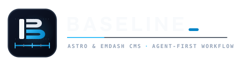

<p align="center">
  
</p>

<p align="center">
  <a href="https://astro.build/"></a>
  <a href="https://docs.emdashcms.com/"></a>
  <a href="https://tailwindcss.com/"></a>
  <a href="#-60-second-quickstart"></a>
  <a href="LICENSE"></a>
</p>

<p align="center">
  <a href="#-60-second-quickstart"><strong>Quickstart</strong></a> ·
  <a href="docs/prompt-library.md"><strong>Prompt Library</strong></a> ·
  <a href="#-where-to-look-in-your-browser"><strong>Browser Dev URLs</strong></a> ·
  <a href="#in-browser-visual-developer-tools"><strong>Visual Dev HUD</strong></a> ·
  <a href="#the-7-stage-site-delivery-workflow"><strong>7-Stage Workflow</strong></a> ·
  <a href="docs/README.md"><strong>Documentation</strong></a>
</p>

---

EmDash is a modern, lightweight headless CMS built ground-up for AI-native web development. Baseline provides the visual frontend foundation, development guardrails, and testing harness built specifically for developers pairing with AI coding assistants—whether using **Claude Code**, **OpenAI Codex**, **Google Antigravity**, **OpenCode / OMP**, **Hermes**, **Cursor**, **Windsurf**, **Aider**, or local LLM runners.

Spend your time building the site, not debugging agent hallucinations or wrestling with styling drift. Baseline gives your AI assistant clear architectural boundaries and provides you with in-browser visual inspection tools: tune design tokens live on the rendered page, align visual concepts or reference screenshots pixel-for-pixel, and stress-test reusable components in isolation before assembling templates. Start locally with Node and SQLite, catch schema-width problems early, and deploy with confidence.

---

## ⚡ 60-Second Quickstart

**Requirements:** Node 22.22.2 minimum (Node 24 LTS recommended) and `npm`.

```sh
# 1. Clone the repository and install dependencies
git clone https://github.com/Vermeulen-Solutions/emdash-baseline.git my-site
cd my-site
npm install

# 2. Generate initial encryption secrets and start local dev server
npx emdash secrets generate --write .env
npm run dev
```

### 🖥️ Where to look in your browser

Once `npm run dev` is running, open these local URLs:

| Destination | Local URL | What it's for |
| --- | --- | --- |
| 🌐 **Public Site** | [`http://localhost:4321/`](http://localhost:4321/) | Live website rendered by Astro |
| ✏️ **CMS Admin** | [`http://localhost:4321/_emdash/admin`](http://localhost:4321/_emdash/admin) | Create your admin account, manage collections, and edit content |
| 🧪 **Component Styleguide** | [`http://localhost:4321/_styleguide`](http://localhost:4321/_styleguide) | Stress-test layout primitives and calibrate typography/spacing (404 in production) |

---

## 🤖 Pairing with Your AI Assistant

Baseline is harness-agnostic. Whether pairing with **Claude Code**, **OpenAI Codex**, **Google Antigravity**, **Cursor**, **Windsurf**, or **Aider**, you never have to guess what to prompt.

### 📋 Starter Prompt: Kick Off a New Site
Paste this exact prompt into your AI assistant to start:

```markdown
Read AGENTS.md, follow new-site-workflow under .agents/skills/, and guide me through the staged delivery workflow.

Here is the context for this project:
- Client / Brand: [Brand Name]
- Purpose: [E.g., B2B marketing site / Portfolio / Directory]
- Target Audience: [E.g., Enterprise buyers / General public]
- Locales: [E.g., Single language (en) or Multilingual (en, fr)]

Please begin with Stage 1 (Brief & Evidence Discovery) and present the Stage 1 handoff choices once complete.
```

### 📚 Ready-to-Copy Prompt Recipes
Need to run a specific task? Copy battle-tested prompt templates directly from our prompt playbook:

👉 **[Open the AI Developer Prompt Library (`docs/prompt-library.md`)](docs/prompt-library.md)**

- 🚀 [Kickstarting a Greenfield Site](docs/prompt-library.md#1-starting-a-new-site-project)
- 🗄️ [Auditing WordPress Content & Finding Hidden Entities](docs/prompt-library.md#2-wordpress-migration--content-modeling)
- 🖼️ [Manifest-Driven WordPress Media Ingestion](docs/prompt-library.md#2-wordpress-migration--content-modeling)
- 🎨 [Art Direction & The Design Gate](docs/prompt-library.md#3-art-direction--the-design-gate)
- 📦 [Quarantining Tailwind Blueprints (21st.dev to Zero-JS Astro)](docs/prompt-library.md#4-component-sourcing--styleguide-quarantine)
- ✏️ [Wiring EmDash Live Edit Proxies](docs/prompt-library.md#5-public-pages--emdash-editorial-canvas)
- 🔍 [Bounded UI/UX Polish with Impeccable Critique](docs/prompt-library.md#6-visual-polish--the-impeccable-critique)
- 📸 [Local Visual Regression Testing (`npm run test:visual`)](docs/prompt-library.md#7-local-visual-regression--pre-launch-checks)
- 🛡️ [Cloudflare Cutover & Corporate Email DNS Safety](docs/prompt-library.md#8-production-cutover--corporate-email-safety)

To connect your coding assistant directly to EmDash's built-in Model Context Protocol (MCP) server for managing content and schema, generate a token in one step:
```sh
npm run mcp:token
```
See [agent documentation](docs/agent-documentation.md) for harness integration and MCP setup across all major tools.

---

## In-browser visual developer tools

Click any thumbnail to view the full-resolution screenshot.

<table>
  <tr>
    <td width="50%" align="center" valign="top">
      <a href="docs/images/reference-overlay.png"></a>
      <br /><br />
      <strong>Mockup Overlay (<code>O</code>)</strong>
      <br />
      <sub>Drop a visual concept (Stitch, Claude Design, OpenDesign, or Figma) or screenshot directly into the running browser. Tune opacity, CSS-pixel offsets, capture DPR, and scrolling modes to align spacing in memory without leaving the dev server.</sub>
    </td>
    <td width="50%" align="center" valign="top">
      <a href="docs/images/ownership-inspector.png"></a>
      <br /><br />
      <strong>CMS Ownership Inspector (<code>P</code>)</strong>
      <br />
      <sub>Spot observed EmDash field annotations (green) versus unannotated copy (amber) before handoff. Missing markers mean <em>unknown</em> rather than automatically broken—use the map to investigate editorial wiring early.</sub>
    </td>
  </tr>
  <tr>
    <td width="50%" align="center" valign="top">
      <a href="docs/images/grid-guide.jpg"></a>
      <br /><br />
      <strong>Container Grid Guide (<code>G</code>)</strong>
      <br />
      <sub>Overlay real container bounds, padding, and 10/12-column responsive layout tracks over your live page to check gutters and alignment across viewports without adding temporary CSS borders.</sub>
    </td>
    <td width="50%" align="center" valign="top">
      <a href="docs/images/styleguide.jpg"></a>
      <br /><br />
      <strong>Component Quarantine & Token Tuning (<code>/_styleguide</code> · <code>T</code> / <code>B</code>)</strong>
      <br />
      <sub>Calibrate components, galleries, and responsive stress-cases in isolation, or press <code>T</code> / <code>B</code> to live-tune fluid typography, spatial density, and OKLCH palettes and export `@theme` CSS in one click. Automatically returns 404 in production builds.</sub>
    </td>
  </tr>
</table>

| Key | What it saves you doing by hand |
| --- | --- |
| **T** | Open token controls (`--text-step-*`, spatial density, OKLCH palettes) and export `@theme` / `:root` CSS |
| **B** | A/B compare temporary live tweaks against your source CSS baseline |
| **G** | Measure container bounds, gutters, and 10/12-column alignment |
| **O** | Align a local reference image in memory without switching applications |
| **P** | Inspect observed EmDash CMS ownership annotations on rendered elements |

Open the drawer before using G/O/P. Shortcuts yield to inputs and editor dialogs; Escape dismisses the active tool before closing the drawer. Changes start without overrides and do not persist across reloads. [Full HUD guide](docs/dev-hud.md).

---

## The 7-stage site delivery workflow

Pairing with an AI coding assistant without a structured process usually results in "one-shot prompt chaos"—where an assistant attempts to do discovery, database schema, responsive layouts, and copy all at once, resulting in broken schemas and generic styling. 

Baseline organizes projects into an explicit 7-stage agency workflow:

1. **Brief & Evidence:** Gather real brand assets, photography, client requirements, and existing site screenshots before touching code.
2. **Platform & Hosting:** Choose Node/SQLite or Cloudflare Workers/D1/R2, keeping Cloudflare's 100-column table limits in mind.
3. **Content Architecture & Candidate Discovery:** Model EmDash collections before writing templates. Hunt for implicit entities trapped in page bodies or ACF repeaters using the [Content Candidate Register](docs/wordpress-content-modeling.md).
4. **The Art Direction Gate:** Establish an aesthetic lane, typography pairings, token physics, section pacing, and explicit anti-patterns in `AGENTS.md` before writing CSS (`npm run check:art-direction`). Optionally explore UX flows (`Nicelydone` / `Refero`), 420+ community `DESIGN.md` systems ([designmd.ai](https://designmd.ai/explore)), or visual concepts (`Google Stitch` / `Claude Design` / `OpenDesign`). [Art Direction Guide](docs/art-direction-workflow.md).
5. **Component Sourcing & Quarantine (`/_styleguide`):** Calibrate reusable components—or transmute external Tailwind blueprints from `21st.dev MCP` into zero-JS, token-bound Astro—in isolation before page assembly (`docs/styleguide-fixtures.md`).
6. **Representative Implementation & Verification:** Build public routes, bind CMS visual edit proxies (`{...entry.edit.title}`), and verify with local visual tests and schema preflights.
7. **Production Cutover, Email & Launch:** Connect custom domains, verify HTTPS/TLS certificates, test admin passkey/email authentication, and preserve corporate mail DNS (Google Workspace / Microsoft 365).

Read the complete [Site Delivery Workflow runbook](docs/site-delivery-workflow.md).

---

## How EmDash & Astro connect

EmDash stores your structured content in local SQLite; Astro renders your server-rendered pages. Binding an entry's data and visual editing proxies takes only a few lines in your `.astro` template:

```astro
---
import Base from '../layouts/Base.astro';

// 1. Receive or query the content entry
const { entry } = Astro.props;
---

<!-- 2. Pass collection identity to Base layout for live editing overlay -->
<Base title={entry.data.title} content={{ collection: 'pages', id: entry.data.id, slug: entry.data.slug }}>
  <!-- 3. Spread field proxies so clients can edit visually in EmDash -->
  <h1 {...(entry.edit.title || {})}>{entry.data.title}</h1>
  <p {...(entry.edit.excerpt || {})}>{entry.data.excerpt}</p>
</Base>
```

See [editorial canvas guide](docs/emdash-editorial-canvas.md) for full field proxy and schema budget rules.

---

## Why Baseline?

### 📐 Fluid design tokens, zero breakpoint soup
Stop writing dozens of arbitrary responsive utility classes (`p-4 md:p-8 lg:p-12 xl:p-16`). Baseline uses continuous mathematical `clamp()` scales anchored between 320px and 1280px viewports:
- **Continuous Typography:** `--text-step--1` through `--text-step-2` (plus high-contrast `--text-step-3-to-1` and `--text-step-2-to-0` bridges) scale smoothly with viewport inline size (`vi`), eliminating jarring font jumps.
- **Fluid Spatial Density:** Section padding (`--spacing-section`) and bridge tokens (`--spacing-2xl-to-md`, `--spacing-xl-to-sm`) automatically expand from mobile to ultrawide monitors.
- **Typographic Measures & Editorial Breakouts:** Built-in line-length bounds (`--measure-reading: 68ch;`, `--measure-content: 76rem;`, `--measure-wide: 88rem;`) and `<Container breakout>` (`.content-grid`) keep body prose readable while allowing figures, pull-quotes, and galleries to break out to wider tracks.
- **Self-Responsive Layout Primitives:** `<Section>`, `<Container>`, auto-fit `<Grid>`, and accessible `<Card>` (`--card-*` tokens, concentric radii, and `.clickable-parent`/`.focus-parent`) adapt to any screen width without media queries. [Design Framework Guide](docs/design-framework.md).

### 🗄️ Intelligent content modeling & WordPress migration
Don't copy WordPress's legacy mess into your clean CMS. Baseline provides a structured methodology for converting legacy sites to EmDash:
- **The Content Candidate Register:** Uncover implicit operational entities trapped in page builder accordions or ACF repeaters (e.g. rosters, schedules, venues, sponsors) and elevate them to first-class collections.
- **Relational Normalization vs 50-Column Budget:** Model 1:N relations and shared master data instead of bloated JSON dumps, staying comfortably within Cloudflare D1's 100-column limits.
- **Admin Polish & Non-Routable Collections:** Designate `routable: false` for internal entities, use standardized ASCII slugs in code, and author display labels in the client's working language.
- **Automated Media Migration:** Use `npm run media:migrate-wp` for manifest-driven WordPress attachment preparation, EmDash ingestion, and Cloudflare R2 staging ([Image Delivery Guide](docs/image-delivery.md)). [Content Modeling Guide](docs/wordpress-content-modeling.md).

### 🎨 The Art Direction Gate — Stop generic AI slop
AI coding assistants notoriously default to the same generic "SaaS template" aesthetic (purple gradients, Inter font, oversized floating cards). Baseline enforces an automated pre-implementation check (`npm run check:art-direction`): before writing visual CSS, the assistant must record a distinct **Aesthetic Lane**, **Typography Pairing**, **Token Physics**, and 2–3 explicit **Site Anti-Patterns** in `AGENTS.md`. Pair code-first tuning with community `DESIGN.md` systems ([designmd.ai](https://designmd.ai/explore)), visual prototyping (**Google Stitch**, **Claude Design**, **OpenDesign**), UX flow teardowns (**Nicelydone**), and **21st.dev** component quarantine via the [AI-Native Design & DESIGN.md Interchange Guide](docs/design-interchange.md). [Art Direction Workflow](docs/art-direction-workflow.md).

### 🛡️ Catch wide schemas before they reach production
Local SQLite can accept models that exceed Cloudflare D1's [100-column table limit](https://developers.cloudflare.com/d1/platform/limits/). Baseline's automatic `check:schema-budget` preflight measures physical collection columns, including generated and retained legacy columns, against a conservative **50-column budget** before build/typecheck. For offline structural diffing, allowlisted seed exports, and isolated D1 snapshot reconstruction, use `npm run db:diff`, `npm run db:export-seed`, and `npm run db:pull-remote` ([Database parity workflow](docs/database-workflow.md)).

### 🧪 Fix components once, before building twenty pages
Open **`/_styleguide`** to calibrate components, controls, galleries and responsive stress cases in isolation. Stage 4.5 component quarantine makes shared problems visible before page assembly multiplies them. Normal production builds return **404** for the route and exclude the development HUD; explicit test fixtures use a separate build profile.

### 🚀 Ship less JavaScript (Progressive Enhancement)
`LogoTicker` renders on the server and animates with CSS: **0 KB of component client JavaScript**, an accessible native checkbox pause toggle, reduced-motion fallback and RTL support. `PhotoGallery` uses pure CSS flexbox to compute proportional justified photo rows without JS Masonry, loading PhotoSwipe only when a user clicks for a lightbox.

### 📸 Catch regressions locally, keep CI lean
Compare mobile, tablet and desktop captures with pinned Windows Chromium. Exercise active motion, no-JS rendering, zoom and text spacing alongside screenshot diffs. No paid visual-testing SaaS or Docker setup is required, and browser tests consume **no GitHub Actions minutes**: they run locally, outside production builds and deployments. Baseline changes require an explicit, reviewed `--update`.

### 🤖 Keep AI coding assistants disciplined and on rails
Building client sites with AI coding assistants—across any harness or tool runner—is fast, but assistants often struggle with headless CMS architectures. Without clear constraints, they tend to invent unnecessary wrapper components, hardcode text that clients should be able to edit in the CMS, or introduce subtle layout breaks on mobile viewports.

Baseline includes a structured workflow designed to keep coding assistants disciplined and aligned with the site's architecture:
- **Art direction gates before implementation:** Before writing visual code, the agent is directed to record aesthetic decisions in `AGENTS.md` (typography pairings, spatial density, and anti-patterns).
- **CMS editorial preservation:** Guidance in `.agents/skills/` explicitly defines EmDash's row-per-locale structure and field-proxy attributes (`data-emdash-ref`).
- **Component quarantine (`/_styleguide`):** The workflow directs the agent to calibrate reusable primitives and responsive edge cases in isolation on `/_styleguide` first.
- **Fast, self-verifying feedback loops:** `check:schema-budget`, `test:visual`, fast unit tests, and typechecking run locally in seconds.
- **Maintainable specialist skills:** Guidance is modularized into specialist skills under `.agents/skills/` that can be updated from upstream via `npm run sync:site-skills` without overwriting project instructions. [Agent setup guide](docs/agent-documentation.md).

---

## Where to work (project layout)

| Path | Purpose |
| --- | --- |
| `src/pages/` | Server-rendered public routes (`/`, `/about`, `/posts/[slug]`, `/_styleguide`) |
| `src/layouts/Base.astro` | Core layout shell, EmDash live-editing script, and header/footer |
| `src/components/` | Reusable layout primitives (`Section`, `Container`, `Grid`, `Card`, `LogoTicker`) |
| `src/styles/global.css` | Neutral Tailwind v4 `@theme` tokens, typography, and base rules |
| `seed/seed.json` | Initial Posts/Pages schema and starter content |
| `src/live.config.ts` | EmDash live collection registration |
| `astro.config.mjs` | Astro configuration (Node adapter, EmDash SQLite setup, Tailwind v4) |
| `.agents/skills/` | Modular specialist skills for AI coding agents |
| `docs/` | Complete documentation guides (see [docs/README.md](docs/README.md)) |

---

## Daily commands

| Command | Use it for |
| --- | --- |
| `npm run dev` | Develop the site and open `/_styleguide` |
| `npm run typecheck` | Astro/TypeScript diagnostics and schema preflight |
| `npm run check:schema-budget` | Measure the local database's physical collection widths |
| `npm run db:diff` | Compare offline SQLite/D1 schema parity and column budgets |
| `npm run media:migrate-wp` | Manifest-driven WordPress media preparation, CMS ingestion, and R2 staging |
| `node --test tests/*.test.mjs` | Run the unit and tooling tests |
| `npm run test:visual` | Compare local Windows captures with reviewed baselines |
| `npm run test:dev-hud` | Exercise HUD alignment, ownership and keyboard behavior |
| `npm run check:dev-tools` | Verify development tools stay out of production |
| `npm run build` | Build the Node production artifact |
| `npm run start:local` | Run that artifact with your local `.env` |
| `npm run audit:site -- --root ../my-site` | Diagnose a downstream repository without changing it |
| `npm run check:upstream` | Review Astro, adapters, EmDash and Node version updates |

Browser tests need the exact renderer described in [visual regression setup](docs/visual-regression.md). CI uses one Node version for fast checks and a normal build; screenshot comparisons remain local.

---

## Build with content, not around it

Use the neutral Tailwind v4 tokens and small `Section`, `Container` and `Grid` primitives as your starting API. Keep editorial content in EmDash, forward field attributes to the stored value being rendered, and verify save/reload before handoff. Put site imagery in `src/assets/` or EmDash Media Library so native processing and ownership stay clear.

[Component quarantine](.agents/skills/astro-site-design/references/component-quarantine.md) · [Editorial canvas](docs/emdash-editorial-canvas.md) · [Gallery workflow](docs/gallery-workflow.md) · [Image delivery](docs/image-delivery.md).

The default runtime is **Node + SQLite + local media**, with no cloud account needed. Cloudflare Workers is an optional site-specific target; its adapter, D1/R2 bindings and image delivery need separate setup and verification. When deploying to Cloudflare or switching nameservers, always follow the DNS checklist to preserve client corporate email. [Production Deployment & DNS Checklist](docs/production-deployment.md) · [Hosting setup](.agents/skills/emdash-site-setup/SKILL.md) · [Supported standards and roadmap](standards/releases/0.1.1.md) · [Downstream audits](docs/site-standards-audit.md).

---

## Contribute

[Contributing](CONTRIBUTING.md) explains verification and upstream skill ownership. Baseline's own contributions use the [MIT license](LICENSE); bundled materials retain their [third-party notices](THIRD_PARTY_NOTICES.md). Participation follows the [Code of Conduct](CODE_OF_CONDUCT.md).
