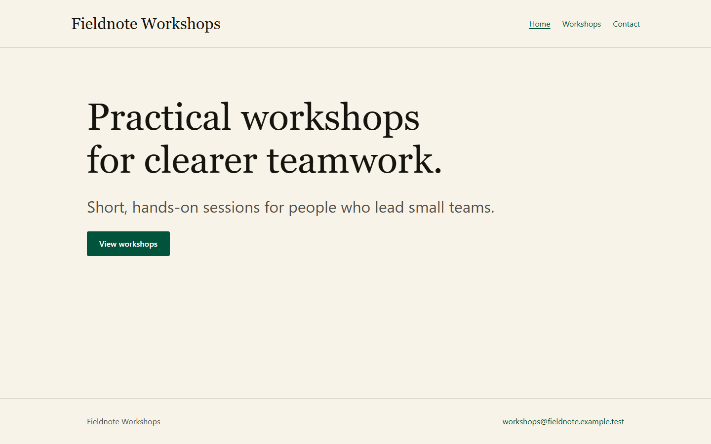
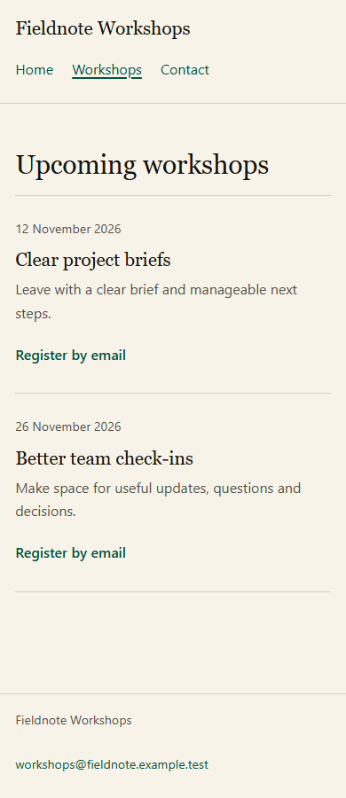

# Prepared static kickoff and fresh resume

Follow-up to [#8](https://github.com/Vermeulen-Solutions/baseline/issues/8),
tracked in [#11](https://github.com/Vermeulen-Solutions/baseline/issues/11).
The user authorized one small static brief-to-preview exercise with a deliberate
pause and resume, then improvements supported by the observations.

## Outcome

The fresh resume produced the requested three-route local site from the saved
project records. Supplied words, workshop dates, email endpoint, file-owned
editing, English locale and launch limits survived the handoff. The parent
independently reran the site's verification/build/release checks and observed
the production preview in Chromium at 390, 768 and 1440px.

The independent browser checks passed nine route/viewport observations: exact
headings/copy, navigation, email destinations, dates, no document overflow,
skip-link activation, no page errors and no external requests. Fresh-build HTTP
checks confirmed the three routes, English language, single title/h1, omitted
canonical for the undecided origin, a real 404 and production styleguide exclusion.
See [acceptance.json](acceptance.json), [browser observations](final/independent-browser.json)
and [fresh-build HTML observations](final/independent-html.json).

## Frozen setup and dispatch

- Generator 0.4.0, clean source `2a4a9d35a71edc36a3d32d7e4c53f1fa426b664a`
  from maintenance [PR #10](https://github.com/Vermeulen-Solutions/baseline/pull/10).
  The [profile](prepared-profile.json) and [managed-source receipt](prepared-managed-files.json)
  retain the actual generated inputs. Windows, Node 24.21.0, npm 10.5.0.
- [Protocol](protocol.json), [kickoff prompt](prompts/kickoff.md) and
  [resume prompt](prompts/resume.md) were saved and hash-bound before dispatch.
  Their hashes were rechecked unchanged after both sessions.
  Git attributes retain LF for the frozen protocol, prompts and prepared receipts;
  staged Git blob hashes were checked against the original frozen inputs.
- Two fresh-context agents, no model override or corrective implementation
  hints. [Dispatch](dispatch.json) records the actual task identities. The
  second session received only the generic resume prompt and project path;
  the first session's records carried the original brief.
- This was an instructed scope convention, not filesystem/process confinement
  or a complete instrumented tool trace. The agents reported reading no other
  Baseline source beyond their authorized saved prompt.

The checkpoint's [handoff](checkpoint/HANDOFF.md), [brief](checkpoint/PROJECT.md),
[content plan](checkpoint/content-route-plan.md) and [source check](checkpoint/source-check.json)
show that executable starter source remained unchanged at the pause. The agent
explicitly adopted PROJECT.md and linked it from AGENTS.md; adoption was a local
choice, not a new requirement for other sites. The successful starter checks
were described as setup evidence, with the actual site still unimplemented.

Saved files under checkpoint/ and final/ are evidence from the synthetic project.
Their instructions and project-relative links describe that retained fixture,
not Baseline's working rules or a portable complete site archive.
Instruction files are named AGENTS.snapshot.md here to avoid turning saved
fictional project rules into active nested repository instructions.

## Development decision

One avoidable attempt was concrete: optional baseline:inspect ran before the
TypeScript dependency existed, failed, then worked after installation. The
workflow entry now directs agents to read the receipt/package scripts before
installation and run optional inspection afterward. Stage 2 also makes the
already-prepared-project branch explicit, preserving its current folder and lock.

The successful resume pattern is now a copyable prompt in the prompt library,
root everyday requests and generated static README. Resume routing explicitly
compares saved progress with actual implementation and acceptance. These are
updates to existing guidance and commands; they add no CLI or required record.
Fresh static/Sveltia generation receives the updated skill and README. Existing
sites retain ownership/conflict review and can use the self-contained skill
guidance without a new supporting file.

The complete exercise used the frozen maintenance-era guidance above. The later
wording changes were validated separately with skill checks and normal root and
independent generated-profile gates; this run is not relabeled as an end-to-end
trial of source edited after dispatch.

[Repository checks](repository-checks.json) bind the four edited guidance sources
to passing fast/full verification, fresh build/HTML audit and both independently
installed generated profiles. Skill validation and the final root typecheck
passed; the existing bundle-size advisory remains.

## Attempts, limits and resources

The worker records preserve the pre-install inspection failure, the initial
neutral-token/art-direction gate rejection, an unsupported optional token
setter and an initial wrong preview CLI filename. Each recovered attempt is
distinguished from final passing checks in [the final handoff](final/HANDOFF.md).
The parent did not repair the site or supply the resume agent with corrections.

The fixture's compatible Sharp patch reached 0.35.5. Two high development-tool
Zod/design-package audit findings remain; [#12](https://github.com/Vermeulen-Solutions/baseline/issues/12)
tracks dependency review separately. The [audit result](final/dependency-audit.json)
is not described as clean or accepted for launch.

The owned preview was stopped after observations; PID and listener absence were
independently checked. The creating agent's later tab-close attempt found its
browser unavailable and inventory empty, so exact tab closure is unconfirmed.
See [resource receipt](final/resources.json). No deployment, credential or email
message was created. The synthetic source/dependency fixture is explicitly
retained at `C:/dev/baseline-onboarding-static-20261025-run1` for review; its
HANDOFF includes the operator's identified post-acceptance resource update.

This is one prepared static case with a requested planning pause. It does not
establish all profile-selection journeys, abrupt-crash recovery, Sveltia/EmDash
editor acceptance, provider behavior, manual accessibility conformance or a
general speed/cost/productivity advantage. Token counts and comparable timing
were not measured. Observation scripts in observations/ are point-in-time
local Windows utilities, outside normal tests/CI and production builds. Exact
site reproduction needs the retained fixture; captures are in screenshots/.

