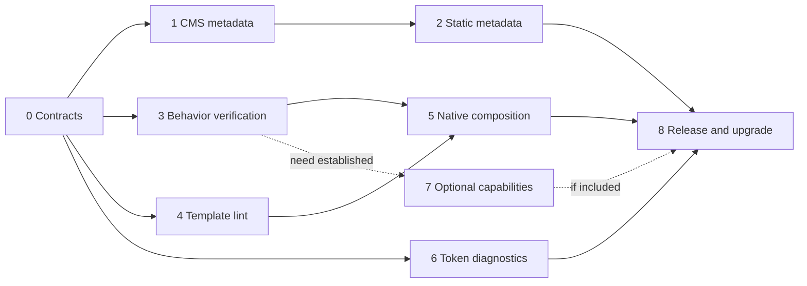

# Phased implementation plan: Baseline architecture hardening

**Status:** proposed implementation sequence; no production changes are implemented by this document.

**Basis:** [architectural evaluation](architecture-evaluation-2026-10-19.md) and its [pinned source evidence](architecture-evaluation-2026-10-19.sources.json), plus a follow-up review of profile generation, downstream synchronization, static browser verification, and form recovery.

**Target outcome:** strengthen the existing EmDash and static foundations through consistent metadata, native interaction primitives, intrinsic composition, and reusable verification. Preserve one Tailwind v4 design system and the existing content-ownership boundaries. The core release does not depend on adding a modal, drawer, or image-generation service.

The evaluation's passing result—177 tests and clean Astro diagnostics—is historical evidence for that evaluation. Every implementation phase must record its own current results; the number of tests is not a target to preserve.

## Scope and governing decisions

1. Shared primitives remain framework-neutral Astro presentation. EmDash queries, edit identities, sessions, storage resolution and plugin contributions remain in the CMS branch.
2. Native static collections, publication filters and Markdown rendering remain in the static branch. Sveltia continues editing those same files and must match any schema changes.
3. `SiteShell` retains document structure, the single title, global CSS, skip link and main landmark. Each platform supplies one owner for the remaining metadata. CMS keeps `EmDashHead`; static receives a small static metadata renderer.
4. Existing components and APIs remain stable unless a phase documents a concrete incompatibility. `Card` remains a semantic composite with slots; this project does not turn every composite into an empty wrapper or introduce a universal Hero.
5. Keep `@theme`, existing semantic roles, lane presets and the token CLI authoritative. No second palette, Tailwind configuration or design-token engine is introduced.
6. Use native HTML first. No new public React or Svelte runtime is required for metadata, disclosures, intrinsic layouts or token diagnostics.
7. Browser acceptance remains explicit and local. No screenshot, Playwright browser installation, axe browser scan or screen-reader session is added to automatic CI or production build dependencies.
8. New shared files, dependencies and scripts must be explicitly inventoried. Existing generated sites cannot acquire them through ordinary `sync:baseline`; adoption requires a reviewed upgrade procedure.

This is starter infrastructure maintenance. Do not seed a fictional client Art Direction Record or recalibrate the default brand to satisfy a gate. Review exact path/hash exceptions for eligible infrastructure changes. Any actual client visual redesign still requires its own saved record and pre-implementation gate.

## Delivery map

| Phase | Priority | Deliverable | Depends on | Suggested PR boundary |
| --- | --- | --- | --- | --- |
| 0 | P0 | Ownership contracts, fixture inventory and upgrade classification | Existing evaluation | A: contracts and plan |
| 1 | P0 | Correct CMS metadata ownership, article semantics and canonical origin | 0 | B: CMS metadata |
| 2 | P0 | Static metadata model and safe JSON-LD | 0–1 shell contract | C: static metadata and profiles |
| 3 | P0 | Foundational keyboard and form journeys across applicable profiles | 0; metadata assertions use 1–2 | D: interaction contracts and fixtures |
| 4 | P1 | Enforced Astro accessibility linting | 0 | E: template lint and inventory |
| 5 | P1 | Native Disclosure and evidenced layout primitives | 3–4 | F: Disclosure; G: layout relationships |
| 6 | P1 | Numerical token diagnostics and container-scope policy | 0; rendered checks use 3 | H: token verification |
| 7 | Conditional | Navigation/modal and OG capabilities with demonstrated need | Relevant earlier contracts | I/J: separate optional capabilities |
| 8 | P0 delivery | Profile verification, release evidence and downstream upgrade rehearsal | Core phases 1–6; optional work only if included | K: release and upgrade guide |

Phase 4 and the mathematical part of Phase 6 can proceed independently of metadata work. This describes technical dependencies; it does not require multiple agents or simultaneous branches. Keep one integration path so shared manifests and fixture changes remain reviewable.



## Phase 0 — establish contracts and evidence before refactoring

**Objective:** convert the evaluation into testable responsibilities and prevent duplicate implementations.

### Work

- Inspect current installed Astro/EmDash APIs and repository state when implementation starts. Use the local skills and configured documentation MCP where API behavior needs confirmation; do not refresh upstream skills as a prerequisite.
- Record a metadata ownership table covering charset, viewport, title, description, canonical, robots, OG/Twitter, JSON-LD and hreflang. Distinguish shell-owned structure from platform-resolved metadata.
- Inventory route archetypes: home/listing, CMS Page, CMS Post, static Post, 404, shared styleguide and production-hidden fixture routes. Include query strings, trailing slash, a non-root base path, and localized content as synthetic test cases where supported.
- Record feature applicability: session-backed form recovery is CMS-only; shared error markup is portable; Sveltia authentication/publishing is distinct from public-page acceptance.
- Document the upgrade class of every intended change: existing shared file update; new shared path; client-owned wrapper/route change; new package/script; optional feature.
- Capture a clean starting `npm run verify` result and initial public JS request inventory for representative local production routes. Include route, profile, build mode and whether CMS search/gallery is present. The JS inventory establishes a comparison point; it is not a budget invented from dependency size.

### Files

- Add `audit/architecture-implementation-contracts.md` for ownership, route cases and applicability.
- Add `audit/architecture-implementation-progress.md` with per-phase status and evidence links.
- Consult `profiles/manifests/shared.json`, `profiles/file-inventory.json`, `profiles/dependency-inventory.json`, `docs/baseline-updates.md` and `docs/support-boundaries.md`.

### Exit gate

Every later phase has an explicit owner, test surface and profile classification. No application change is required in this phase. Record existing defects as findings rather than committing a default test command that remains intentionally red between PRs; add each regression test together with its fix, or keep exploratory probes outside default gates.

**PR A:** contracts, evidence structure and this plan. Small, documentation-led review.

## Phase 1 — correct CMS metadata without bypassing EmDash

**Objective:** remove duplicate metadata and represent Posts as articles while preserving editor and plugin ownership.

### Implementation

1. Add a small metadata ownership option to `SiteShell`. Keep the current default for callers that still use shell description/canonical. When the platform owns metadata, omit those two shell outputs and retain the existing head slot.
2. Update CMS `Base.astro` to use platform metadata ownership and continue rendering `EmDashHead`, `EmDashBodyStart` and `EmDashBodyEnd` with the same page context.
3. Type `pageType` and `articleMeta` against the installed `CreatePublicPageContextInput` export. Posts supply article semantics and real dates/author data; ordinary Pages/custom routes keep the appropriate website semantics. Do not infer that every CMS content row is a BlogPosting.
4. Resolve canonical defaults from configured public site settings, then Astro's site configuration, then an intentional local-development fallback. Preserve supported editor canonical overrides and plugin precedence. Avoid using a preview/request host as the production default.
5. Preserve route caching: every settings/menu/content query used by a cached route must have its applicable cache hint registered. Reuse request-cached values where supported rather than querying again solely for SEO.
6. Keep `<title>` template-owned and verify its composition separately. Document title and social-title differences when intentionally supported. Do not append the site name twice to an already resolved title.

### Primary files

- `src/layouts/SiteShell.astro`
- `src/layouts/Base.astro`
- `src/pages/posts/[slug].astro`
- `src/pages/[slug].astro`
- `tests/metadata.test.mjs` or equivalent focused test module
- Existing owned server-fixture helpers for rendered CMS evidence

Update the public-page ownership description in `docs/platform-profiles.md` and `profiles/README.md` so “shell owns metadata” does not conceal the platform delegation. Review infrastructure exception hashes for changed source files.

### Acceptance cases

| Case | Required outcome |
| --- | --- |
| Normal CMS Post | One document title; one applicable description/canonical; `og:type=article`; BlogPosting when required input exists |
| CMS Page/home/listing | Website semantics; no fabricated article dates |
| Editor SEO override | Canonical/description/social fields resolve through supported EmDash behavior |
| Plugin override | Supported metadata contribution wins without a second shell tag |
| Preview/alternate request origin | Canonical default remains the configured public origin |
| Missing optional image/author/date | Omit unknown facts or use one documented fallback; no invented publisher identity |
| 404 | Real 404 status; explicit indexing/canonical policy rather than forcing an ordinary content-page expectation |
| Cached route | Metadata changes do not bypass registered content/settings/menu invalidation |

Parse rendered HTML for counts and values. Source-string checks alone cannot prove deduplication. Test pure URL/title policy in the fast suite, then exercise template integration in the owned local server fixture.

### Exit gate and PR

`npm run verify` and `npm run build` pass. Local representative HTML confirms ownership and article semantics. The static wrapper still works through the backward-compatible shell default until Phase 2 migrates it.

**PR B:** CMS metadata ownership and article correctness, with regression evidence. Rollback is limited to the shell/wrapper/route change set; no database migration is needed.

## Phase 2 — complete static metadata and safe structured data

**Objective:** give both static profiles equivalent public metadata capabilities without importing EmDash.

### Implementation

1. Define a small resolved metadata model independent of Astro request globals, content storage and CMS types. Include title/description, absolute canonical, optional resolved image and its known metadata, page kind, locale and real article facts.
2. Separate default generation from explicit overrides. Normalize default canonical URLs using the configured public origin and actual base/trailing-slash/build-format policy. Remove tracking query/hash where irrelevant; retain meaningful parameters only under an explicit route policy. Do not lowercase case-sensitive paths.
3. Add `StaticMetadata.astro` and switch the generated static Base wrapper to platform metadata ownership. The renderer owns description/canonical/robots/social/schema output; SiteShell retains charset/viewport/title. Keep all social/schema fallbacks derived from the same resolved model.
4. Add a dependency-free JSON-LD serializer with HTML-safe escaping. Accept schema objects, not editor-authored script markup. Build only supported graph variants from actual content. No FAQ schema is inferred from using a Disclosure.
5. Adapt static posts from the existing validated schema and publication filter. Prefer optional fields and site-level defaults over forcing content migrations for simple metadata coverage.
6. If adding editorial SEO fields is justified, update the Astro schema and Sveltia form together. Validate an editor-shaped Markdown file, dates, image paths, required/optional behavior and publication filtering. Do not add a social-image override field merely because a benchmark has one.
7. Define preview/fixture origin behavior explicitly. Synthetic local builds use a known fixture URL; release verification checks a configured public URL. Do not make ordinary offline unit tests depend on DNS or an external website.
8. Keep static-only renderer/helpers in the static overlay unless CMS or shared infrastructure actually uses them. The generated target can still be `src/components/StaticMetadata.astro`; source ownership need not be the root shared component inventory.

### Primary files

- Proposed overlay files: `profiles/static/project/src/components/StaticMetadata.astro`, `src/lib/metadata.ts` and `src/lib/json-ld.ts` beneath that overlay.
- `profiles/static/project/src/layouts/Base.astro`
- `profiles/static/project/src/pages/posts/[...id].astro`
- `profiles/static/project/src/config/site.ts`
- Schema and `profiles/static-sveltia/project/public/admin/config.yml` only if content fields change.
- Portable tests in the generated project's `tests/` through explicit mappings; root tests for generator/inventory contracts.
- Relevant static manifest overrides and source/dependency classifications.

### Acceptance cases

- Single metadata values where applicable, correct article type and dates, and stable canonical/OG/schema identity.
- Explicit and fallback image URLs are absolute; declared type/dimensions reflect known assets rather than a universal PNG assumption.
- Parser-based adversarial JSON-LD tests: closing-script text, quotes, ampersands, Unicode separators, round-trip JSON and no injected element.
- URL cases: root, nested slug, configured base, slash policy, query/hash, explicit supported cross-domain canonical and missing optional data.
- Drafts excluded consistently from HTML routes and any metadata inventory.
- Locale alternates represent published translations. Do not invent a multilingual static routing system in this phase if the profile does not yet support it.
- Both generated profiles independently install, verify and build; static dependency graphs contain no EmDash/SQLite/React/server-adapter leakage.

### Exit gate and PR

Run root `verify`, focused metadata tests, `npm run test:profiles`, and the existing static pilot's HTTP checks. Record rendered metadata from independently generated static and Sveltia projects.

**PR C:** static metadata/serialization and all required profile mappings. Document wrapper adoption separately for existing generated sites because `Base.astro` is client-owned.

## Phase 3 — foundational interaction verification across profiles

**Objective:** turn generic user journeys into reusable local acceptance, preserving the existing harness investment.

### Harness work

- Extend `tests/visual/behavior.spec.mjs` for the CMS-owned fixture application rather than introducing a second screenshot framework.
- Extend `tests/static-pilot.integration.mjs --browser` for independently generated static projects. It already checks production/styleguide isolation, images, narrow overflow and a small focus sequence. Retain its actual capabilities; do not describe static browser verification as nonexistent.
- Extract small shared journey functions only when both adapters need the same behavior. Keep server creation, sessions, build/artifact checks and cleanup platform-specific. Do not introduce a generic test-runner framework to share a few assertions.
- Treat fixture identity, correct HTTP status, local readiness, external request accounting, clean page errors and teardown as prerequisites.
- Keep public static acceptance independent of Sveltia's remote bundle/authentication. Its existing sign-in smoke check is a separate integration result, not proof of GitHub publishing.

### Required journeys

| Journey | Concrete assertions | Applicability |
| --- | --- | --- |
| Skip link | First intended Tab reaches link; activation focuses main; next Tab reaches a known main control; target visible and unobscured | All public profiles |
| Field error linkage | Label and error ID references resolve; invalid state matches content; summary link focuses the intended field | Shared specimen |
| Real form recovery | Invalid POST → redirect/render → bounded retained values → focus/error discovery → correction → successful result | CMS synthetic handler |
| Repeated failure | Errors persist appropriately after another invalid submit; changing one field does not erase unrelated errors | CMS synthetic handler |
| Recovery boundary | No sensitive/unallowlisted retention; consumed/expired state behavior is explicit; session unavailable path remains usable | CMS unit/integration |
| No-JS public behavior | Navigation remains available, native controls function, essential media/content has a usable fallback | All applicable profiles |
| Motion | Reduced-motion behavior is real; no explicit smooth skip animation; retain active ticker/pause/print assertions | Shared/CMS specimens as available |
| Reflow | Long labels, 320px host/text-spacing and actual zoom checks retain content and keyboard usability | Existing authoritative local suite; scoped static pilot extension |

### Form fixture design

Use a synthetic, fixture-only form route with deterministic invalid/success outcomes and the existing `src/lib/form-recovery.ts` helpers. Do not connect email, payments, production APIs or client business rules. Build and release guards must prove the route and fixture markers absent from production output. Shared FormError markup remains portable; static sites require their own real submission-service contract and do not inherit server sessions.

Choose one focus/announcement policy per response mode: server-rendered error summary versus dynamically updated status. A `role=alert` node in initial HTML is not, by itself, a reliable announcement/focus policy. Preserve native required/format validation unless the form intentionally implements a complete custom validation flow.

### Evidence and exit gate

Run local Windows `npm run test:visual:functional` for relevant CMS cases and the static pilot browser command for both generated profiles. Preserve normal/fixture artifact separation. Record browser, OS, route, modality, preference and expected state. Manually check representative keyboard and screen-reader behavior; record untested combinations rather than claiming WCAG conformance.

No browser tests enter default CI or `verify`. Fast unit/structural tests cover helper contracts and fixture exclusion. This phase establishes the contract later Disclosure/Dialog changes must pass.

**PR D:** fixtures and generic journeys. Browser-only failure handling must not replace the existing offline helper tests.

## Phase 4 — enforce template accessibility linting

**Objective:** catch authoring defects in Astro templates while retaining script syntax checks and type checking.

### Implementation

1. Select compatible ESLint/Astro/parser packages against installed versions, with npm lockfile review. Reuse the Accessible Astro strict configuration pattern after confirming current package exports; do not paste a configuration for a different major version.
2. Add `lint:scripts` for the existing syntax checker and `lint:templates` for template semantics. Let `lint` run both so current `verify` automatically gains enforcement.
3. Root lint targets actual source and static overlay source. Generated sites target their own `src` only and receive an appropriate configuration/script through explicit inventory.
4. Correct genuine errors in repository-owned code. Map custom components only where the semantic output is known. Avoid broad overrides that silence unknown generated markup, global rule disabling, or suppressions based on client convenience.
5. Keep the scope bounded: Astro accessibility lint does not replace rendered checks or require vendoring the entire benchmark configuration/toolchain.

### Files and scripts

`eslint.config.mjs`, `package.json`, `package-lock.json`, static overlay config when necessary, `profiles/dependency-inventory.json`, relevant manifest script overrides and generated tests.

```json
{
  "lint:scripts": "node scripts/check-script-syntax.mjs",
  "lint:templates": "eslint src profiles/static/project/src --max-warnings 0",
  "lint": "npm run lint:scripts && npm run lint:templates"
}
```

The generated override for `lint:templates` is `eslint src --max-warnings 0`. Confirm configuration paths and dependencies through actual independent installation. Do not add missing CMS dependencies to satisfy a generated lint configuration.

### Exit gate and PR

Introduce a small temporary template defect during validation and confirm the intended rule rejects it; remove the defect and rerun. Both root and generated `verify` pass. No browser executable is installed by lint or its CI setup.

**PR E:** lint configuration, script wiring and narrowly scoped source corrections. Explain any reviewed per-line exceptions.

## Phase 5 — add native composition in quarantine

**Objective:** provide a small set of portable primitives whose behavior is established before site-page adoption.

### 5A. Native Disclosure

- Add `src/components/Disclosure.astro` with ordinary details attributes, one named summary slot and a body slot inside `.flow`.
- Preserve native toggle/expanded semantics and the native marker initially. Do not add a JavaScript controller, heading-title prop system, automatic FAQ schema, or hand-maintained ARIA state.
- Document summary content restrictions, meaningful labels, exclusive-name grouping and headings/AT checks.
- Keep editor attributes on the caller's summary/body content. Static examples use native Markdown; CMS examples use their own Portable Text adapter.
- Use existing border, text, surface, focus and spacing roles. Add no new global brand values.

**Verification:** shared specimen, keyboard Enter/Space, hidden body links outside tab order when closed, no-JS, long/translatable labels, dark surface, text spacing, zoom, multiple instances, native find-in-page/hash reveal where supported. Do not claim browser Find from a synthetic beforematch dispatch alone.

**PR F:** Disclosure, specimens, usage contract, inventory/exceptions and focused tests. Add default-open behavior only if it follows a real semantic requirement; do not use disclosure to hide essential client copy indiscriminately.

### 5B. Intrinsic layout relationships

- Add Cluster and Sidebar only where concrete specimens demonstrate an unmet layout need. Keep the existing Grid's narrow-host containment guard.
- Cluster encodes wrapping sibling alignment and gap. Sidebar encodes intrinsic two-region wrapping with documented child order, minimum main share and a contextual sidebar basis.
- Prefer a small CSS relationship before a wrapper API. If Astro components improve consistency, provide slots, class and normal HTML attributes without query/content ownership.
- Preserve DOM reading order. Use logical properties; visual reversal must not masquerade as an RTL localization feature.
- Exercise editorial/editor wrappers, long strings, narrow containers inside wide viewports, missing optional content and intrinsic media sizing.

**Files:** proposed `src/components/Cluster.astro`, `src/components/Sidebar.astro`, `src/styles/global.css`, shared Styleguide specimens and profile inventories.

**Exit gate:** real `/_styleguide` rendering works on both foundations; local behavior/reflow acceptance passes; calibration evidence records the production primitives rather than stand-in copies. Use Impeccable for a bounded rendered critique at this point. Review exact infrastructure exceptions with source changes; do not exempt a client page or directory.

**PR G:** evidenced layout relationships and calibration. Avoid a broad rewrite of existing routes purely to demonstrate the new components.

## Phase 6 — strengthen token mathematics without changing the brand

**Objective:** test the numerical and contextual contracts behind fluid values, preserving lane presets and current CSS authority.

### Implementation

- Add independent endpoint and interpolation checks to existing token tests. Verify below minimum, at minimum, midpoint, maximum and above maximum; detect malformed/non-finite expressions and zero-width interpolation domains.
- Test monotonicity and rounding tolerance. Reversed size pairs are relevant to spacing only if the CLI intentionally supports them; do not accidentally change the ascending type-scale contract.
- Make viewport/reference assumptions explicit. Preserve `vi` for global fluid tokens. Permit `cqi` only when a documented component context establishes an inline-size container, and extend validators/specimens together.
- Use Utopia's calculations as a comparison source, not a runtime dependency or a second generator. Keep independent expected mathematics so a test does not merely rerun the same implementation.
- Test changed root-font assumptions and the interaction between shrinking CSS viewport width and text enlargement. Keep resize-risk calculations advisory until corroborated by rendered acceptance.
- Retain light/dark semantic contrast checks, actual font loading, editor proxy verification and token coverage. Describe the checked ratio accurately; OKLCH values alone do not certify contrast.
- Preserve actual browser zoom and text-spacing tests; numerical success is not a substitute.

### Files and gates

`scripts/design-system.mjs`, existing design/token test modules, narrowly scoped new numerical tests where clearer, and `docs/design-framework.md` for reference-unit and diagnostic interpretation.

Run `npm run design:tokens`, `npm run test:design`, `npm run verify`, and relevant local zoom/reflow cases if emitted CSS or validation scope changes. Existing calibrated tokens must not be silently rewritten. An unchanged valid preset should produce unchanged values unless a separately reviewed bug fix justifies a difference.

**PR H:** diagnostics and regression evidence. No new aesthetic lane, branding change or global fluid-scale replacement.

## Phase 7 — optional capabilities, activated by requirements

These are separate capability PRs. They do not block the core release and should remain explicitly deferred if there is no use case.

### 7A. Responsive navigation and native modal dialog

**Activation:** a real navigation requirement exceeds the current wrapping links, or a client workflow genuinely requires a modal.

First choose the interaction model: ordinary navigation/disclosure, nonmodal popover, or modal dialog/drawer. A popover does not become modal because it visually covers a screen. Native navigation must preserve a usable no-JS/unsupported-browser path and stable focus during breakpoint changes. Do not duplicate CMS-owned navigation data to implement mobile markup.

For modal use, add `Dialog.astro` and a small lifecycle-safe controller. Use `showModal`, native cancel/Escape, caller-owned heading/content/close controls, deliberate initial focus and an essential-content fallback. No document-wide first/last focus selector loop. Track actual invoker semantics, cleanup on disconnect and safe reconnect; nested cases must not close or clean up another instance.

Use the adversarial contracts from Radix/React Aria/Bits: one focusable control, removed focused child, programmatic opener, removed opener, nested layer, shadow-root use only if supported, repeated open/close and route remount. Add meaningful outside-dismiss policy and confirm scroll/pinch/reflow behavior. Do not import a public runtime solely to simplify an ordinary dialog.

**Exit:** local keyboard/no-JS/browser/AT evidence for the promised support scope; component JS transfer measured against Phase 0's route inventory; unchanged production fixture exclusion. If a claimed advanced case is unsupported, document that boundary rather than offering an untested generic API.

**PR I:** navigation or dialog capability with its own requirement and acceptance. Split them if both are needed.

### 7B. Generated OpenGraph images

**Activation:** an actual publishing workflow needs generated social images and supplying editorial assets is insufficient.

- Begin with static build-time assets derived from the same publication/slug helper as HTML routes. Skip draft entries and honor supplied images.
- Keep composition separate from route/data loading. Use reviewed brand tokens and licensed local fonts with real locale glyph coverage.
- Handle long titles and missing optional metadata. Record response MIME type/dimensions and verify the generated image actually exists at the metadata URL.
- Review Satori or another renderer's dependency cost before including it in a profile. Avoid requiring the feature in every static install.
- Treat CMS live generation as a separate implementation: publication access, bounded resource use, revision/font/theme cache key, invalidation, supported media APIs and route cache hints. Do not prerender changing CMS content to reuse a static recipe.
- Keep generated content media in the native asset/build pipeline or CMS Media Library. Do not use `public/` as a staging directory for source imagery.

**Exit:** deterministic static images, real font/locale coverage, draft exclusion, valid metadata references and content/theme update behavior. CMS support is not claimed merely because static generation passes.

**PR J:** optional static OG support first; a separate CMS proposal only if required.

## Phase 8 — release, independently verify, and rehearse adoption

**Objective:** deliver a usable baseline update for new and existing sites without weakening bounded synchronization.

### New-project acceptance

1. Run root `npm run verify` and `npm run build`; confirm release artifact checks and production-hidden fixture routes.
2. Run `npm run test:profiles` so both generated profiles independently install, clean-install, verify, build and undergo existing HTTP checks. Do not rely on the root node_modules through a junction.
3. Run local Windows CMS functional/visual verification for changed rendered behavior and the static browser pilot for independently generated static/Sveltia projects. Verify normal build and fixture build separately.
4. Check native Markdown, storage-resolved CMS media, error recovery where applicable, editor field ownership and metadata overrides.
5. Confirm Sveltia's paired configuration and local sign-in smoke behavior. Credentialed GitHub publishing, hosting-provider behavior and real message delivery remain separate acceptance when requested.

### Existing-project adoption

Classify and document the rollout explicitly:

| Change | Adoption path |
| --- | --- |
| Updated existing managed shared file | Stage immutable upstream revision, review conflicts/hashes, apply eligible update, verify |
| Locally calibrated `global.css` | Preserve calibration; manually reconcile relevant rules/tokens and rerun audits |
| New component/helper/test path | Reviewed additive upgrade procedure; ordinary sync cannot introduce it |
| New lint dependency/script/config | Explicit package/lockfile/config upgrade and independent verification |
| Client-owned Base/route changes | Manual documented patch/example adapted to local ownership; no automatic overwrite |
| New content field/Sveltia form | Reviewed schema/content/form change with compatibility and build evidence |
| Optional capability | Explicit opt-in adoption with its own requirements |

Do not expand `sync:baseline`'s trust ceiling just to make this release easier. Prefer a documented additive upgrade checklist and concrete reviewed patch. If a migration tool is necessary, propose it separately with preflight, dry-run, ownership/conflict behavior and rollback tests; do not silently introduce a force/update-all mode.

Rehearse on two downstream fixtures: one close to generated defaults and one with calibrated tokens, a custom Base wrapper and edited navigation. Show that client-owned changes survive, conflicts remain visible, new dependencies are explicit, and final verification reflects the actually adopted subset.

### Release files and evidence

- `docs/architecture-hardening-upgrade.md`: new versus existing site instructions, per-profile applicability, commands and compatibility notes.
- `docs/reusable-public-patterns.md`, `docs/design-framework.md`, `docs/platform-profiles.md`, `docs/visual-regression.md` and relevant profile README updates.
- `docs/README.md`: link the maintained guidance when implemented.
- Applicable standards/release records and generator version after the actual change set is known.
- `audit/architecture-implementation-progress.md`: links to final PRs/evidence and deferred capability decisions.

**PR K:** release/upgrade documentation and rehearsal receipts after implementation results exist. Do not predeclare a new certified framework version, Cloudflare certification, a successful editor save or WCAG conformance from these checks.

## Verification policy and command matrix

| Change | Fast/default checks | Explicit additional checks |
| --- | --- | --- |
| Metadata/serialization | `npm run verify`; focused parser/URL tests | Local rendered CMS/static HTML; production build |
| Shared inventory or package/script changes | Root verify and inventory tests | `npm run test:profiles`; generated lockfile/dependency review |
| Native component/layout | Verify, design/token checks, template lint | Local Windows functional/visual suite; static browser pilot; manual keyboard/AT scope |
| Form recovery | Existing and new unit/state tests | Synthetic CMS invalid/corrected POST journey |
| Token math only | Token/design tests and verify | Browser acceptance if emitted values or reference scope changes |
| Fixture/server lifecycle | Fixture exclusion/cleanup tests | Start/failure/cancellation/cleanup rehearsal; normal artifact rejection of fixtures |
| Release/update behavior | Verify/build/profile checks | Downstream conflict/adoption rehearsal |

Example static browser acceptance after an independently generated project has completed its own verify/build/fixtures build:

```powershell
node tests/static-pilot.integration.mjs --root C:/dev/baseline-static-acceptance --browser
```

The path is illustrative and must be a real independently installed generated project. Do not run the generator against an existing populated client directory. Do not add that browser command to CI. Keep the established local renderer/version requirements from `docs/visual-regression.md` and avoid updating goldens as an automatic response to failures.

All implementation PRs run `npm run verify`. New `tests/*.test.mjs` modules are already discovered by `npm test`; an optional focused `test:metadata` script can aid development but need not run the same tests twice in the default chain.

## Definition of done and stop conditions

**Core release done** means Phases 1–6 and Phase 8 have passing, current evidence; one metadata owner exists per profile; applicable article/schema behavior is correct; foundational journeys and lint are enforced at their promised scope; primitives stay open-slot/token-bound; profile generation is independent; and existing-site adoption is documented and rehearsed. Optional Phase 7 items can be explicitly deferred.

Pause the affected phase—not unrelated work—if a supported EmDash API cannot preserve editor/plugin precedence, an introduced dependency leaks into the wrong profile, a fixture reaches production output, a proposed source exception masks client implementation, or actual rendered evidence contradicts the assumed behavior. Resolve the concrete issue or reduce the claimed support scope before merging. Missing screen-reader evidence is recorded as missing evidence, not converted into an automated conformance pass.

Avoid success criteria based on component count, a Lighthouse score, number of tests, a zero-dependency slogan, or importing every selected repository. The release succeeds when the existing foundations acquire the specific demonstrated capabilities and their maintenance contracts remain clear.

## Suggested first implementation instruction

> Implement Phases 0 and 1 of `audit/architecture-implementation-plan-2026-10-19.md`. Confirm the current repository state, record the metadata ownership/route contract, fix CMS metadata duplication and article semantics using installed EmDash APIs, preserve editor/plugin precedence and cache hints, add meaningful regression coverage, and run `npm run verify` plus build/local rendered checks. Keep the phase reviewable and update its evidence/status. Leave later phases as planned work.
