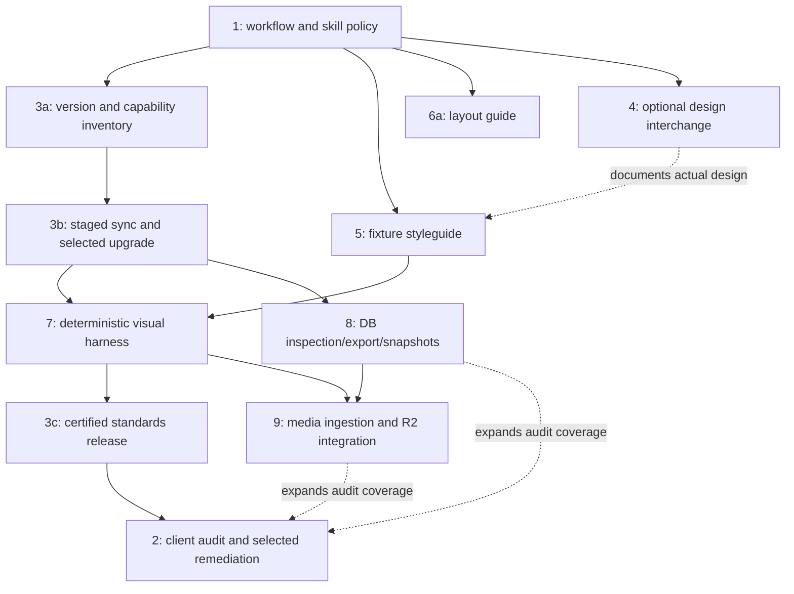

# Architectural peer review — 15 October 2026

The nine proposals form a useful roadmap after correcting the platform baseline, separating evidence from design preference, and defining data/runtime boundaries. All nine refined specifications are in `refined/`; originals, including the existing #3 comment, are in `originals/`. Remote read-back receipts are in `verified/`. Proposed commands in the issues are future deliverables, not commands installed by this review.

## Evidence and scope

- Reviewed local checkout `7be19d11c04257bc60f92cb53e5697695f01d6e2` with pre-existing uncommitted editorial/schema changes. Those changes were preserved. The schema-budget helpers and related package scripts are present locally but not yet a committed/released baseline.
- Read AGENTS.md, README, package/lockfile, route/component/styles inventory, CI, schema-budget, skill-sync and media scripts, plus applicable workflow, design, setup, modeling, migration and CLI guidance. Inspected the installed EmDash annotation implementation.
- Fetched all nine complete GitHub bodies and comments using authenticated `gh issue list/view`. No additional roadmap issues, deployments or client-site modifications were requested or performed.
- Queried the actual Astro Docs MCP and EmDash Docs MCP successfully. They provided framework SSR/image and CMS export/import documentation; current docs are not assumed identical to the installed package.
- Checked installed/locked versions with npm and available versions with registry/GitHub APIs. Node here is 24.21.0; the project engine permits >=22.16 and CI currently selects Node 22. A future certified matrix must select an exact supported minor/image, not assume every permitted version is tested.
- Ran `npm run sync:emdash-skills` through npm's prefix option in an isolated temporary replica because local mirrored skills contain existing edits. Reviewed resulting diffs; no root-workspace skill files/manifests were replaced. Source advanced from `b74679528630a7ffc0f0f45e73bab4e7c5e61abb` to `d10d7ae1bd3a8635b9f67a14aec7226eaa633bda`. The refresh removes local editorial/budget additions from the mirror, updates locale-aware IDs/D1 examples and plugin documentation. This is evidence for staged sync, not a claim that the working checkout is synchronized.
- Google Labs/OpenDesign/Lumos/Cloudflare/Playwright primary documentation was available. YouTube retrieval was throttled; video observations remain supplied notes. No Stitch tools are exposed in this session. External exchange and full browser/database integration were not executed during this architectural review.

## Verified baseline and consequential corrections

| Area | Observed | Roadmap implication |
| --- | --- | --- |
| Framework | package requests Astro ^7.3.2; lock/installed 7.3.5; 7.4.0 now verified available | Use 7.3.5 as the comparison baseline, evaluate 7.4.0 and later stable releases explicitly; treat Astro 5 as legacy input with an upgrade path. |
| CMS | EmDash pinned/installed 1.1.0 | Evaluate exact 1.2/1.3 target with migration evidence. EmDash 1.3.0 appeared in npm and releases during review. |
| Runtime | Node standalone adapter 11.1.6, server output, `file:./data.db`, local uploads | Keep Node default. Add optional Cloudflare profile rather than asserting this checkout is a Worker deployment. |
| CSS | Tailwind 4.3.3, @theme plus ordinary aliases and fluid expressions | DESIGN.md is not a lossless or identical representation of CSS. |
| Forms | Correct npm package @emdash-cms/plugin-forms 0.2.10; @emdash/plugin-forms returned 404 | Verify feature parity; submission handling and answer recovery are different contracts. |
| HUD | B compares original source; transient scalar settings | Do not repurpose B or persist overrides/references by default. |
| Canvas | 1.1.0 uses data-emdash-ref JSON; production can use no-op proxies | Inspector observes annotations; it cannot infer registration/saveability or label all UI text a defect. |
| Skills | Site sync checks commit only; EmDash sync has no --check; content-modeling missing from site allowlist | Add hash/ownership-aware staged synchronization and distribute required local guidance. |
| Content | Generic _emdash live loader; public posts live under /posts | Do not validate seed collections against live.config keys or capture nonexistent /blog routes. |
| Database | 50 physical columns is project budget; D1 documents 100 platform cap | Count hidden/generated/legacy columns; also test expanded queries and other D1 limits. |

## Issue-by-issue critique and resolution

| Issue | Main weakness in original proposal | Refined contract and closure evidence |
| --- | --- | --- |
| [#1](https://github.com/Vermeulen-Solutions/emdash-site-starter/issues/1) | Unsupported framework comparisons, harness-specific rules presented as universal, blanket CSS bans, upstream skill scope mischaracterized | Keep existing stack as a maintenance choice; add evidence-led reference to maintained skill; preserve canonical AGENTS gate; require responsive/editor examples and upstream ownership safeguards. |
| [#2](https://github.com/Vermeulen-Solutions/emdash-site-starter/issues/2) | Diagnosis mutates skills/data, automatic aesthetic retrofits, scans overclaim editor/schema proof | Versioned read-only JSON/Markdown audit; explicit unverified state; selected recipes with preconditions, tests and rollback; authorized pilot after standards and harness. |
| [#3](https://github.com/Vermeulen-Solutions/emdash-site-starter/issues/3) | Floating upgrade targets, incorrect forms package, future tools used as existing tests, skill manifest blind spots | Exact runtime/capability matrix; staged hash-aware sync; optional forms evaluation; tested release process; mandatory new-site registry workflow with private/pending paths, retaining the existing comment's intent. |
| [#4](https://github.com/Vermeulen-Solutions/emdash-site-starter/issues/4) | Alpha format called universal, YAML example/schema mismatch, several competing authorities and assumed tools | Optional pinned interoperability bridge; CSS is shipped truth and AGENTS controls the gate; mapped-token drift checks and loss evidence; accounts/connectors not required. |
| [#5](https://github.com/Vermeulen-Solutions/emdash-site-starter/issues/5) | Invented theme/component APIs; dev-only surface conflicts with built-server visual tests | Demonstrate actual primitives/variants; deterministic shared fixtures; explicit loopback fixture build; default production GET/HEAD 404 and separate deployment artifact. |
| [#6](https://github.com/Vermeulen-Solutions/emdash-site-starter/issues/6) | Incorrect B behavior/attribute name, unsafe editing shortcuts, overlay persistence and false proxy diagnoses | Independent G/O/P slices; accurate CSS-pixel/document coordinates; no screenshot persistence/upload; version-aware read-only annotation adapter; typing/navigation/production isolation tests. |
| [#7](https://github.com/Vermeulen-Solutions/emdash-site-starter/issues/7) | Missing seeded SSR environment, fake route names, arbitrary tolerance, blanket pre-commit cost | Pinned Playwright/Linux environment and actual Node server; isolated fixture DB/media; readiness/content/asset assertions; calibrated full-page + targeted captures; explicit baseline review. |
| [#8](https://github.com/Vermeulen-Solutions/emdash-site-starter/issues/8) | Wrong local path/package, parity conflated with sync, raw DB-to-seed dump, overwrite escape hatch | Read-only structural/registry/seed layers; supported export-seed wrapper; new private inspection snapshots; explicit targets/statuses and no working-DB overwrite; transfer/seed limitations documented. |
| [#9](https://github.com/Vermeulen-Solutions/emdash-site-starter/issues/9) | Lossy crop/original pruning, forced size/format, internal SQL hydration, unverified R2 helper | Native importer/media API, immutable originals, source/usage-aware manifest, optional preparation, separate upload journal/receipt, target/hash-scoped storage verification and repeat-run safety. |

## Dependency graph and overlap decisions

Dependencies are at deliverable level. Making every entire issue block the next creates a cycle: #3 wants future visual/DB/media checks, while those checks need #3's tested API baseline. Split #3 into inventory/upgrade/release slices and #6 into G/O/P. Later capabilities recertify a release; they do not prevent writing the first runbook.

- #1 owns rules; #3 implements sync/distribution. Neither patches upstream mirrors to enforce policy.
- #4 documents design interoperability; #5 renders code. CSS is not generated from speculative provider output at runtime.
- #5 provides fixtures; #7 owns capture orchestration and numerical diff. #6 provides manual alignment diagnostics, not a second diff engine.
- #3 owns starter certification; #2 owns per-client adoption. The registry does not authorize client messaging or bulk changes.
- #8 owns schema/export/snapshot adapters; #9 owns asset identity/ingestion/storage. Neither provides automatic bidirectional production synchronization.
- #2 can report DB/media scopes unverified until #8/#9 ship; dependent remediation remains unaccepted until those scopes are verified.

## Cross-cutting blind spots added to acceptance

1. Local success does not certify Worker runtime behavior. Node and Cloudflare adapters, native image services and migration state need separate evidence.
2. Artifact mode matters: dev convenience, loopback fixture build and deployable release must be independently checked. noindex is not access control. Implementation verification corrected a review error: Astro excludes underscore-prefixed files from file-based routing, so /_styleguide requires explicit injection plus its production response guard.
3. Static markup/regex cannot prove a field is populated, registered, owned correctly or saveable. Actual editor saves are separate from screenshot passes.
4. Offline/missing permissions/missing DB must remain unverified. Current zero-exit schema check on a missing DB is not certification.
5. Audit artifacts and snapshots can contain private data. Use synthetic fixtures in public CI; keep production exports/registry metadata in access-appropriate storage.
6. Goldens preserve observed behavior, including possible defects. Baseline changes need review; accessibility/keyboard/reflow/editor/data checks remain independent.
7. Filesystem, R2 and CMS writes are not one transaction. Preserve identity and journal partial progress with verified retries and bounded rollback.
8. Published version availability, current documentation and installed API support are different facts. Verify all three at implementation time.

## Primary references

Follow-up requested by the user: evaluate [Astro 7.4](https://astro.build/blog/astro-740/) explicitly and make future framework-release evaluation mandatory in #3. Retrieved the full announcement directly from astro.build after the web tool could not access it; npm metadata and the Astro Docs MCP independently confirm the release. No documented 7.3 hold was found in package history: the initial ^7.3.2 declaration admits 7.4; the lockfile provides reproducibility. Installed EmDash/Node-adapter peer ranges also admit 7.4, but runtime compatibility is untested. Node >=22.22 is a real 7.4 requirement that exceeds this repository's advertised >=22.16 floor. The updated plan specifies joint framework/CMS/adapter evaluation, image-service and handler/font checks, experimental-feature boundaries, and recorded adopt/defer decisions at each future meta-review.

- [EmDash 1.3 release](https://github.com/emdash-cms/emdash/releases/tag/emdash%401.3.0), [forms package source](https://github.com/emdash-cms/emdash/tree/main/packages/plugins/forms), [CLI/seed export](https://docs.emdashcms.com/reference/cli/), [site transfer](https://docs.emdashcms.com/guides/site-transfer/), [WordPress import](https://docs.emdashcms.com/migration/content-import/).
- [Astro SSR](https://docs.astro.build/en/guides/on-demand-rendering/), [image services](https://docs.astro.build/en/reference/image-service-reference/), [Node adapter](https://docs.astro.build/en/guides/integrations-guide/node/).
- [DESIGN.md specification/tooling](https://github.com/google-labs-code/design.md), [OpenDesign](https://github.com/nexu-io/open-design), [Lumos](https://lumosframework.com/docs/).
- [D1 limits](https://developers.cloudflare.com/d1/platform/limits/), [Wrangler D1 commands](https://developers.cloudflare.com/d1/wrangler-commands/), [Playwright visual comparisons](https://playwright.dev/docs/test-snapshots), [CI](https://playwright.dev/docs/ci).

See `implementation-plan.md` for phased delivery, gates and rollout.
