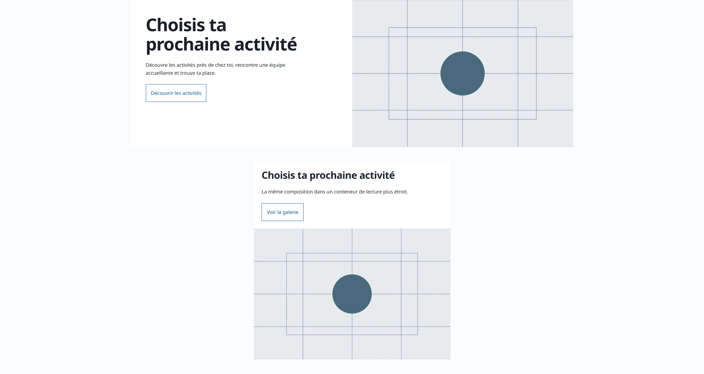

# Workflow acceptance and efficiency — batches 2 and 3

Scope authorized: merge batch 1, preserve existing main changes, then complete the media/editorial/design acceptance and bounded efficiency follow-ups. Batch 1 is merged; pre-existing conversion guidance and issue-29 research were committed separately as `651645e`. Their research prototypes remain outside distributed checks. No client data, site redesign, hosting, forms backend or deployment is part of this release.

| Finding | Implementation | Acceptance |
| --- | --- | --- |
| F4 library and repeated links | Native readback comparison CLI; planned names/folders, exact URL and alt/caption checks; scoped recovery/naming guidance. | Neutral photos/PDF/link fixtures, missing metadata/records and no input mutation. Native UI usability/complete byte inventories remain project-specific. |
| F5 canvas opening path | Maintained selected-surface handoff gate: one current comparison entry, clear history, refresh/open instructions in chat and actual selected-app verification. | Existing client correction is historical evidence. New prose is not proof that every future agent will perform the handoff correctly. |
| F6 responsive composition | Neutral split layout in full-width/constrained contexts, local-language expansion and ultrawide sensitivity test. | Local Windows rendered review; document overflow alone cannot pass composition. No public layout/golden change. |
| F7 imported semantics | Read-only Portable Text/HTML diagnostics and optional normalized text comparison, with no auto-normalization. | Neutral flattened heading/paragraph/poetry/media cases; real native editing remains a migration acceptance step. |
| F8 stable preview and bounds | Validated 2–512 SSR resource budget, default 64/deadline retained; existing isolated built-server harness reused. | CLI/API bounds and larger crawl, hung cleanup, gallery behavior across root typecheck; no second preview service. |
| F9 runtime/adoption/resume | Explicit target/inventory guidance, single existing plan with phase receipts and promotion/registry refresh. | Preserve Node inspection and client ownership; no orchestration engine, config execution or new live Cloudflare claim. |

## Verification — 30 October 2026

Final root `verify` passed **236 unit + 158 rehearsal tests**, with zero Astro errors/warnings/hints across 53 files. Fresh production build/release validation and HTML integrity passed: nine HTML documents, ten public responses. Both generated profiles passed independent install/clean-install, verification, production/fixture builds and HTTP checks, with zero database packages. These receipts bind the tested working-tree bytes based on `651645e`, not clean artifacts of that earlier commit. The dependency lockfile is unchanged; existing advisories are not reported as zero vulnerabilities.

The focused local Windows renderer passed **eight cases**: keyboard skip-link behavior and uncropped gallery behavior at 390/768/1440px, the built gallery before/after a fresh root typecheck, and the French/English full-width/constrained matrix at 320/768/1440/2293/3840px. Four deliberate project skips avoid repeating the same ten-width matrix and root typecheck in all three projects. Native library/locale/image-field readbacks passed in the owned temporary app. The wide-layout sensitivity probe verified a genuine squeezed-copy defect and a clean revert; it uses CSSOM without weakening CSP. No real client media, data, credentials or source databases were copied into this app. The existing owned lifecycle stopped its processes and removed its temporary app.

Early fixture attempts caught a wrong asset path, an unintended second main landmark/gutter owner, arbitrary button-width assumptions and an ineffective defect injection. Those were corrected before accepting the final rendered result. The fixture now uses the existing prepared sample, one shell main, explicit full-width gutter ownership, usable tap areas/content fit and a polled viewport-derived defect. A green overflow count or unchanged words alone did not substitute for the rendered review.

## Broader visual limits and the focus repair

The initial broader functional run stopped at three failures: a skip link obscured by the sticky header, plus `ticker-active` and `ticker-reduced` golden mismatches at 390px. A controlled run of the earlier committed `62d8eab` source reproduced all three. The header sits at layer 40 while the skip link was at 10. Raising the neutral shared skip link to 100 repaired actual keyboard visibility, verified on all three standard viewports. Its exact source exception hash was refreshed; no client art direction or inactive-page layout was changed.

The two unrelated ticker reference differences remain: a one-pixel capture-height difference and raster differences under the same pinned renderer. **The complete visual suite is not claimed green.** Existing goldens, zero-pixel tolerance and renderer policy were preserved; they were not refreshed to hide these failures. Separate ticker/reference calibration remains a known acceptance limit outside these workflow changes. The earlier comparison and failed-run diagnostics are retained privately in `.emdash/backups/workflow-batches-2-3/` (and the earlier-source worktree's matching private directory).

Selected-canvas opening guidance still needs observation on future projects to establish whether it prevents a repeat of the owner handoff failure. Likewise, the runtime-overlay test establishes preserved Node inspection/source ownership, not a new live Cloudflare certification. Native save/publication and whole-library completeness remain project-specific acceptance; the diagnostics do not certify them automatically. No site deployment is applicable to this starter release.

## Adoption and rendered evidence

New EmDash clones receive the two read-only migration review commands and runbooks. Static profiles receive applicable shared workflow/visual guidance, bounded HTML tooling and the focus fix without CMS dependencies. Existing sites need selective reviewed adoption, preserving calibrated tokens, source ownership and installed membership. The visual harness/proof remains maintainer-only; its temporary routes are not distributed as public pages. No client is automatically updated by this release.

