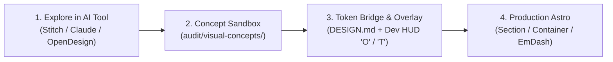

# Visual Prototyping & DESIGN.md Bridge (Stitch, Claude Design, OpenDesign)

When designing a new website or major page template, external visual AI tools—such as **Google Stitch**, **Claude Design / Artifacts**, **OpenDesign**, or **Figma**—offer rapid concept exploration.

Baseline provides a structured, account-free bridge to explore visual directions with these tools **without polluting your production codebase** or breaking your site's fluid responsive architecture with raw AI-generated markup.

---

## 1. The 4-Step Prototyping Workflow



### Step 1: Brainstorm Concepts Externally
Use your preferred visual prototyping tool to generate page layouts, color schemes, and component compositions:
- **Google Stitch:** Generates screen designs and structured `DESIGN.md` token specifications.
- **Claude Design / Artifacts:** Rapidly mocks up HTML/CSS prototypes and visual layouts.
- **OpenDesign / Figma:** Visual canvas tools exporting design tokens and high-resolution mockups.

### Step 2: Keep Concepts in the Sandbox (`audit/visual-concepts/`)
Never paste raw AI-generated HTML or arbitrary CSS utility classes directly into `src/pages/` or `src/styles/global.css`:
- AI visual generators frequently output rigid, fixed-width layouts (`w-[1440px]`), hardcoded text strings, and flat color palettes that bypass EmDash CMS bindings.
- Store exploratory HTML, CSS, and screenshots under `audit/visual-concepts/<concept-name>/` (e.g. `audit/visual-concepts/neutral-interchange/`).
- Files in `audit/` are excluded from the Art Direction Gate, giving you full freedom to experiment without triggering CI or preflight errors.

### Step 3: Token Validation & Visual In-Browser Alignment
Bridge the visual prototype into Baseline using the `DESIGN.md` token specification and the Dev HUD:

1. **Token Interchange via `DESIGN.md`:**
   If your tool exports or consumes the Google Labs `DESIGN.md` standard, validate and lint the document against Baseline's mapping sidecar:
   ```sh
   npm run design:check -- --file audit/visual-concepts/neutral-interchange/DESIGN.md --mapping audit/visual-concepts/neutral-interchange/mapping.json
   ```
   To export tokens to CSS custom properties:
   ```sh
   npm run design:export -- --file audit/visual-concepts/neutral-interchange/DESIGN.md --format css-vars
   ```

2. **Pixel-for-Pixel Mockup Overlay (`O`):**
   - Export your concept as a PNG or JPEG screenshot from Stitch, Claude, or Figma.
   - Run `npm run dev` and open `/_styleguide` or any public route.
   - Press **`O`** to open the Reference Overlay in the Dev HUD drawer.
   - Drop the screenshot into the browser, adjust opacity, and use the arrow-key offset pad to align padding and gutters pixel-for-pixel.

3. **Live Token Calibration (`T` / `B`):**
   - Press **`T`** to tune typography scales, line-heights, tracking, and spatial density live on the rendered page until it matches the concept.
   - Press **`B`** to A/B toggle against your source CSS.
   - Click **Copy Tokens** to export clean Tailwind `@theme` CSS and merge it into `src/styles/global.css`.

### Step 4: Translate into Semantic Astro & EmDash CMS
Once the visual concept is approved:
1. Translate layout structures into Baseline's semantic primitives: `<Section>`, `<Container>`, and `<Grid>` (`docs/design-framework.md`).
2. Bind EmDash CMS live editing field proxies (`{...entry.edit.title}`) so clients can edit copy visually (`docs/emdash-editorial-canvas.md`).
3. Ensure photographic assets use Astro native image delivery (`docs/image-delivery.md`).

---

## 2. Specification & Token Mapping Details

Baseline pins the lockfile-pinned `@google/design.md@0.4.0` CLI (using the Windows-compatible `designmd` alias) and the alpha specification at commit `9bf8eae`.

A reference implementation with full sidecar mappings is checked into [`audit/visual-concepts/neutral-interchange/`](../audit/visual-concepts/neutral-interchange/).

### Observed Format Mappings & Schema Boundaries

External token schemas often flatten modern CSS features. Baseline's mapping sidecar (`mapping.json`) accounts for these boundaries:

| Source Token / Case | `DESIGN.md` Representation | Observed Limitation in 0.4.0 |
| :--- | :--- | :--- |
| `--color-action` (OKLCH) | `colors.primary` accepts raw OKLCH expression | `css-vars` export converts to sRGB hex; original gamut intent is lost. Retain OKLCH in source. |
| Semantic Alias | `{colors.primary}` | Export duplicates the resolved value instead of preserving the token reference. |
| Fluid scales (`clamp()`) | Retained in `mapping.json` and prose | Alpha Dimension schema cannot express `clamp()/calc()/vi`. Never flatten fluid scales into fixed px sizes. |
| Body font stack | `typography.body.fontFamily` | Lint accepts partial roles; `css-vars` exporter omits typography when `fontSize` is absent. |
| Control radius | `rounded.control` | Namespace differs from production `--radius-control`. Review before merging. |
| Surface & focus roles | Documented in sidecar prose | `data-surface="dark"` changes contextual focus ink; no independent full dark theme is inferred. |

---

## 3. Guiding Rules

- **Source Code is Authoritative:** `src/styles/global.css` and Astro component templates own production values. `DESIGN.md` acts as an external bridge, not a build dependency.
- **No Direct Overwriting:** Never redirect `design:export` directly over `global.css`. Always review exported tokens and merge them deliberately.
- **Account-Free:** No Google Stitch, Claude, or OpenDesign paid account is required. The local offline verification path (`npm run design:check`) works completely offline.
