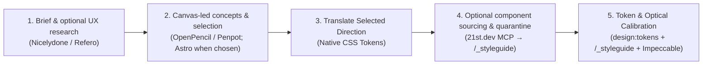

# AI-Native Visual Design, Component Sourcing & DESIGN.md Interchange

`DESIGN.md` holds selected visual references, rationale and interchange snapshots. The compact gate record stays in `AGENTS.md`, CSS owns shipped values, and an optional adopted `PROJECT.md` holds the client brief rather than another design system. See [document scope and conflict handling](project-context.md).

Baseline installs no `DESIGN.md` validator or exporter. The default path uses the Art Direction Record, `src/styles/global.css`, `npm run design:tokens` and rendered calibration on `/_styleguide`. External files and tools are optional aids to that workflow; they do not add another canonical token source.

When an AI coding assistant is asked to "build a modern landing page" from a single text prompt, it almost always regresses to statistical averages: indigo-to-purple gradients, `Inter` everywhere, uniform `rounded-xl shadow-md` 3-column card rows, and thin, lifeless layouts lacking real-world UX details.

Baseline's design workflow starts with the brief, native CSS tokens and rendered calibration. The following optional research, concepting and component sources can help resolve particular design questions. Use the relevant steps without requiring any external service or token format.

## Design surface and agent arrangement

For new sites and substantial overhauls, recommend canvas-led iteration and offer **OpenPencil**, **Penpot** and **direct Astro/browser** explicitly. Prefer an already working user-preferred canvas; OpenPencil supports local files, Penpot supports a shared cloud artifact, and direct Astro remains a complete no-service option. Retain explicit preferences for Pencil, Google Stitch, OpenDesign or Claude Design. Follow `site-art-direction/references/design-iteration.md`: focused representative concepts → meaningful direction selection → native Astro proof → rollout, rather than a mandatory chain of tools or a full duplicate site in each surface. Penpot uses `penpot-site-design` and [onboarding](penpot-onboarding.md); OpenPencil uses its upstream skill/API and [onboarding](openpencil-onboarding.md). Same-agent work is complete; switching agents is optional. A canvas remains a design reference, with source CSS/content authority and real browser acceptance.

---

## 1. The 5-Stage Design Alchemy Pipeline



### How the optional tools fit together

These tools overlap; select the smallest useful set for the task rather than treating them as required pipeline dependencies:

| Layer | Tool / Service | What It Provides |
| :--- | :--- | :--- |
| **1. UX Flows & Anatomy** | **Nicelydone MCP** / **Refero.design** / **Kombai** | Real-world page flows, filter bars, secondary metadata, and empty states. |
| **2. Macro Design System** | **[designmd.ai](https://designmd.ai/explore)** (`designmd-mcp`) | 420+ free community `DESIGN.md` design systems (colors, font pairings, elevation, guidelines). |
| **3. Visual Screen Prototyping** | **Penpot** / **OpenPencil** / **Pencil** / **Google Stitch** / **OpenDesign** / **Claude Design** | Choose a shared canvas, local desktop artifact or generated concept according to the task; inspect actual capabilities and translate selected decisions into native Astro. |
| **4. Micro-Component Blueprints** | **21st.dev MCP** (`@21st-dev/magic`) | High-craft Tailwind component structures & micro-interactions (transmuted to zero-JS Astro). |
| **5. Token & Optical Calibration** | **`npm run design:tokens` + `/_styleguide` + `impeccable`** | Automated WCAG contrast & fluid scale verification, `/_styleguide` specimen checks, and UI critique. |

---

### Step 1: Real-World UX & Flow Teardowns (`Nicelydone` / `Refero` / `Kombai`)
Before inventing sections from scratch, ground your layout in real production UX anatomy:
- **Nicelydone MCP & Refero.design:** Search real-world web and SaaS screens, onboarding flows, directories, pricing tables, and navigation shells.
- **Kombai Gallery:** Browse curated web screens structured for AI coding prompts.
- **What to extract:** Do not copy a brand's colors or logo. Extract **structural UX anatomy**:
  - What secondary metadata makes a card or table row feel credible (timestamps, category tags, status dots, hairline dividers)?
  - How does the page vary its **section pacing** (alternating dense multi-column index grids with spacious asymmetric feature spotlights)?
  - What empty, filter, or mobile disclosure states are needed?

### Step 2: Macro Design Systems (`designmd.ai`) & Visual Concepting (`audit/visual-concepts/`)
When exploring visual mood, typography, and surface contrast, combine community `DESIGN.md` systems with generative screen studies inside the isolated `audit/visual-concepts/<concept-name>/` sandbox:
- **Browse or Query [designmd.ai/explore](https://designmd.ai/explore) (`designmd-mcp`):** Search 420+ curated community `DESIGN.md` files by tag (`minimal`, `dark`, `warm`, `landing-page`, `accessible`, `bold`) directly from your agent—searching works without an API key, and downloading uses a free key ([setup guide](agent-documentation.md)).
- **Google Stitch + `DESIGN.md` Synergy:** Google Stitch natively reads and emits `DESIGN.md`. Your agent can download a starting `DESIGN.md` from `designmd.ai` (or author one from Baseline's Aesthetic Lanes), pass it to Stitch (`create_design_system_from_design_md` / `generate_screen_from_text`) to generate 2–3 visual screen concepts anchored in your **Narrative Metaphor**, and save the captures in `audit/visual-concepts/<concept-name>/`.
- **Claude Design / OpenDesign:** Rapidly prototype layout variations and typographic pairings.
- **Why the Sandbox Matters:** Never paste raw AI-generated prototype HTML directly into `src/pages/`. AI visual generators frequently output fixed-width containers (`w-[1440px]`), hardcoded copy, and flat sRGB hex codes that bypass EmDash CMS bindings. Files in `audit/visual-concepts/` are exempt from the Art Direction Gate so you can iterate freely before committing to production code.

### Step 3: Translate the Selected Direction into Native Tokens

An external `DESIGN.md` may contain plain Markdown, structured YAML tokens or both. Read it as reference material. Baseline does not require a particular schema or parse it during verification.

1. Review the selected concept against the brief and record the direction in `AGENTS.md`. Preserve source provenance, rationale and any mapping decisions alongside the reference under `audit/visual-concepts/<concept-name>/`.
2. Translate suitable decisions into `src/styles/global.css` and components. Preserve semantic roles, OKLCH colors, aliases, contextual surfaces and fluid `clamp()` type/spacing scales. Avoid flattening these to exported fixed values.
3. Run `npm run design:tokens`, then inspect and calibrate the rendered result on `/_styleguide`. A valid exchange document cannot establish visual quality or accessibility of the implemented site.

If a specific handoff requires deterministic validation or export, choose a validator that supports the recipient's format. Review its version, dependency advisories and output limitations, and install it in a separate tooling workspace with its own package file and lockfile. Run it explicitly there and review any output before translation. No automatic install or network fallback is part of Baseline's build or checks. The former `design:check` and `design:export` commands have been retired; `design:tokens` remains the native audit.

Google's [`@google/design.md`](https://github.com/google-labs-code/design.md) and the community registry's `designmd` package are different tools that both use the `designmd` binary name. Select the intended package explicitly when using either externally. The previously bundled Google 0.4.0 release has unresolved dependency findings recorded in [the dependency review](dependency-review-2026-10-25.md); its removal is not a recommendation to install that release elsewhere.

### Step 4: Component Sourcing (`21st.dev MCP`) & The Zero-JS Quarantine (`/_styleguide`)
Once your macro design tokens are set in `src/styles/global.css`, your agent can query the **21st.dev MCP** registry to fetch polished, high-craft Tailwind component blueprints (e.g., bento grids, editorial timelines, interactive accordions, subtle spotlight cards, or split-sticky sections) rather than hallucinating complex UI from scratch.

> [!IMPORTANT]
> **The Baseline Quarantine Rule:** Never drop raw external registry code directly into a public route. Every sourced component must pass through **`/_styleguide` Quarantine** using the **5-Step Transmutation Protocol**:

1. **De-Reactify to Zero-JS Astro:** Strip unnecessary React state, `framer-motion` wrappers, and client hydration (`client:*`). Convert JSX into native `.astro` markup using pure CSS transitions, `@keyframes`, native `<details>/<summary>`, or CSS `:has()` / checkbox toggles wherever possible.
2. **Map Hardcoded Palette Classes to Semantic Tokens:** Replace hardcoded Tailwind colors (`bg-zinc-900`, `text-slate-400`, `border-white/10`) with Baseline's surface-aware semantic tokens (`var(--color-surface)`, `var(--color-text)`, `var(--color-muted)`, `var(--color-border)`, and `data-surface="dark"`).
3. **Fluidize Typography & Spacing:** Replace rigid pixel utilities (`text-4xl`, `p-10`) with Baseline's fluid typographic steps (`--text-step-2`, `--text-step-3`) and structural primitives (`<Section>`, `<Container>`, `<Grid>`, `.flow`).
4. **Bind EmDash Live Edit Proxies:** Accept and forward CMS field attributes (`{...entry.edit.title}`) so the component is live-editable inside the EmDash Visual Editor (`docs/emdash-editorial-canvas.md`).
5. **Stress-Test on `/_styleguide`:** Verify narrow (`320px`/`390px`), intermediate (`768px`), and wide (`1440px`) viewports, long translated strings, missing media, keyboard focus rings, and `prefers-reduced-motion`.

#### Example: Transmuting a Raw Registry Snippet into Production Astro

````carousel
```tsx
// ❌ BEFORE: Raw React/Tailwind snippet from external registry
// Problems: Requires React runtime, hardcoded zinc/indigo hex colors,
// rigid px sizes, and static uneditable strings.
import { motion } from "framer-motion";

export function FeatureSpotlight({ title, category, description }) {
  return (
    <motion.div
      initial={{ opacity: 0, y: 12 }}
      animate={{ opacity: 1, y: 0 }}
      className="rounded-2xl bg-zinc-900 border border-zinc-800 p-8 shadow-xl"
    >
      <span className="text-xs font-mono uppercase tracking-widest text-indigo-400">
        {category}
      </span>
      <h3 className="mt-3 text-3xl font-bold text-white">{title}</h3>
      <p className="mt-4 text-base leading-relaxed text-zinc-400">{description}</p>
    </motion.div>
  );
}
```
<!-- slide -->
```astro
---
// ✅ AFTER: Transmuted Zero-JS Astro component calibrated on /_styleguide
// Benefits: Zero client JS, semantic surface/ink tokens, fluid typography,
// and live EmDash CMS visual editor bindings.
interface Props {
  title: string;
  category?: string;
  description: string;
  edit?: {
    title?: Record<string, unknown>;
    category?: Record<string, unknown>;
    description?: Record<string, unknown>;
  };
}

const { title, category, description, edit } = Astro.props;
---

<article class="feature-spotlight flow" data-surface="dark">
  {category && (
    <p class="feature-spotlight__eyebrow" {...edit?.category}>{category}</p>
  )}
  <h3 class="feature-spotlight__title" {...edit?.title}>{title}</h3>
  <p class="feature-spotlight__body" {...edit?.description}>{description}</p>
</article>

<style>
  .feature-spotlight {
    background: var(--color-surface);
    color: var(--color-text);
    border: 1px solid var(--color-border);
    border-radius: var(--radius-card);
    padding: var(--space-l);
    transition: border-color 180ms ease, transform 180ms ease;
  }
  @media (prefers-reduced-motion: no-preference) {
    .feature-spotlight:hover {
      transform: translateY(-2px);
    }
  }
  .feature-spotlight__eyebrow {
    font-family: var(--font-mono);
    font-size: var(--text-step--1);
    letter-spacing: 0.08em;
    text-transform: uppercase;
    color: var(--color-action);
  }
  .feature-spotlight__title {
    font-family: var(--font-display);
    font-size: var(--text-step-2);
    line-height: 1.15;
  }
  .feature-spotlight__body {
    font-size: var(--text-step-0);
    color: var(--color-muted);
    max-width: 62ch;
  }
</style>
```
````

### Step 5: Automated Token Calibration & Optical Critique (`design:tokens` + `Impeccable`)
Once your components are mounted on `/_styleguide` and representative routes:
1. **Parametric Scale & WCAG Contrast Audit (`npm run design:tokens`):** Generate or refine fluid typography/spacing scales (`--type-scale`, `--space-scale`) and OKLCH brand palettes (`--seed-accent`), verify all 10 WCAG AA contrast pairs across default and `[data-surface="dark"]` contexts, and export the Stage 4.5 calibration table (`npm run design:tokens -- --write-calibration`).
2. **Responsive & Edge-Case Inspection (`/_styleguide`):** Inspect typography measures, `<Container breakout>` tracks, and `<Card>` states across `390px`, `768px`, and `1440px` viewports with live Vite HMR.
3. **Bounded Visual Critique (`impeccable`):** Run a bounded **`impeccable`** critique pass on rendered routes to eliminate visual monotony before scaling across all routes.

*(Note: If a client happens to supply an existing Figma file, you can optionally connect the official Figma MCP server to inspect layer tokens directly, then follow Steps 3–5 above.)*

---

## 2. Historical Token Mapping Findings

The retired bridge used `@google/design.md@0.4.0` and the alpha specification at commit `9bf8eae`. These observations describe that reviewed version; they are not a compatibility promise for other releases or a requirement for current sites.

The historical neutral specimen and sidecar mappings remain in [`audit/visual-concepts/neutral-interchange/`](../audit/visual-concepts/neutral-interchange/) as reference evidence. They are not installed into generated sites or executed by the current checks.

### Observed Format Mappings & Schema Boundaries

The historical mapping sidecar (`mapping.json`) documented these boundaries:

| Source Token / Case | `DESIGN.md` Representation | Observed Limitation in 0.4.0 |
| :--- | :--- | :--- |
| `--color-action` (OKLCH) | `colors.primary` accepts raw OKLCH expression | `css-vars` export converts to sRGB hex; original gamut intent is lost. Retain OKLCH in source. |
| Semantic Alias | `{colors.primary}` | Export duplicates the resolved value instead of preserving the token reference. |
| Fluid scales (`clamp()`) | Retained in `mapping.json` and prose | Alpha Dimension schema cannot express `clamp()/calc()/vi`. Never flatten fluid scales into fixed px sizes. |
| Body font stack | `typography.body.fontFamily` | Lint accepts partial roles; `css-vars` exporter omits typography when `fontSize` is absent. |
| Control radius | `rounded.control` | Namespace differs from production `--radius-control`. Review before merging. |
| Surface & focus roles | Documented in sidecar prose | `data-surface="dark"` changes contextual focus ink; no independent full dark theme is inferred. |

---

## 3. Guiding Rules

- **Source Code is Authoritative:** `src/styles/global.css` and Astro component templates own production values. `DESIGN.md` and external registries act as bridges, never runtime dependencies.
- **Review Exchange Output:** Never redirect an external export over `global.css`, and never paste un-quarantined registry components directly into `src/pages/`.
- **Optional External Tools:** Every external MCP (`designmd-mcp`, `21st.dev`, `Stitch`, `Nicelydone`) is optional. Baseline's native token validation and `/_styleguide` calibration work without external design packages or paid accounts.
