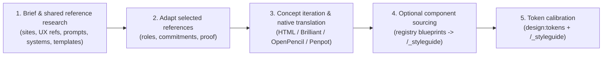

# AI-Native Visual Design, Component Sourcing & DESIGN.md Interchange

`DESIGN.md` holds selected visual references, rationale and interchange snapshots. The compact gate record stays in `AGENTS.md`, CSS owns shipped values, and an optional adopted `PROJECT.md` holds the client brief rather than another design system. See [document scope and conflict handling](project-context.md).

Baseline installs no `DESIGN.md` validator or exporter. The default path uses the Art Direction Record, `src/styles/global.css`, `npm run design:tokens` and rendered calibration on `/_styleguide`. External files and tools are optional aids to that workflow; they do not add another canonical token source.

When an AI coding assistant is asked to "build a modern landing page" from a single text prompt, it almost always regresses to statistical averages: indigo-to-purple gradients, `Inter` everywhere, uniform `rounded-xl shadow-md` 3-column card rows, and thin, lifeless layouts lacking real-world UX details.

Baseline's design workflow starts with the brief, native CSS tokens and rendered calibration. The following optional research, concepting and component sources can help resolve particular design questions. Use the relevant steps without requiring any external service or token format.

## Design Surfaces

For new sites and substantial overhauls, reference discovery follows the shared [reference research](../.agents/skills/site-art-direction/references/reference-research.md) step on every surface. Public/local OpenDesign systems and templates join existing prompt libraries, community references and real websites without requiring its app, daemon or surface skill. Selected references use the existing adaptation pass; they do not choose the editing tool.

Choose a design iteration surface using the shared defaults:

- **HTML/browser (default without a canvas request):** Agent-authored concept files under `audit/visual-concepts/`, with desktop/mobile comparison and real browser behavior.
- **[Brilliant](brilliant-onboarding.md) (recommended when an editable canvas is requested and no tool is settled):** Native editable concepts with the `brilliant-site-design` skill; translate the selected direction into Astro.
- **[OpenPencil](openpencil-onboarding.md):** Local desktop canvas (`openpencil-site-design`) using `.fig` files, vector nodes, and semantic variable bindings.
- **[Penpot](penpot-onboarding.md):** Shared cloud workspace (`penpot-site-design`) for multi-user browser review.
- **[OpenDesign](opendesign-onboarding.md) (optional):** Its canvas/export workflow when explicitly chosen, or an existing project; reference research does not require it.
- **Direct Astro:** Explore isolated concepts under `audit/visual-concepts/` in the browser; after saving and checking the Art Direction Record, translate the selected concept into native CSS, `/_styleguide` and production routes.

Baseline supports two execution models across all surfaces:
- **Single-Agent Model:** The same agent explores concepts on the canvas and translates the approved direction into Astro.
- **Agent Switch Model:** A design agent receives the [portable design brief](../.agents/skills/penpot-site-design/assets/design-brief.md), creates canvas concepts and exports a [design handoff](../.agents/skills/penpot-site-design/assets/design-handoff.md), which an implementation agent then translates into native Astro primitives and routes.

---

## 1. The 5-Stage Design Pipeline



### How the optional tools fit together

Select sources that answer the design question rather than treating every external service as a dependency. Reference discovery belongs to the shared [reference research](../.agents/skills/site-art-direction/references/reference-research.md) step on every surface, and selected sources use the same [adaptation pass](../.agents/skills/site-art-direction/references/external-prompt-adaptation.md). A tool or MCP is an access path, not an extra approval step.

| Layer | Source / Tool | What It Provides |
| :--- | :--- | :--- |
| **1. Reference research (shared)** | Supplied sites and real UX references (**Nicelydone**, **Refero**, **Kombai** where available), prompt libraries, community `DESIGN.md`, OpenDesign public/local systems and templates | A brief-led shortlist of flows, layouts, type/colour/surface rules and composition examples. Public/local files need no app, MCP, account or surface skill; a connected search tool is optional transport. |
| **2. Adaptation** | `design:prompt-check` and the shared adaptation pass | Keep/change/refuse decisions, fixed brand commitments, role mapping and real proof before concepts and implementation. |
| **3. Concept iteration & native translation** | **Brilliant** recommended for a requested editable canvas without a settled tool; **HTML/browser** default without a canvas request; explicit **OpenPencil**/**Penpot** choices; optional **OpenDesign**; `src/styles/global.css` | Two or three distinct concepts compared side by side on the selected surface, one selected direction, then a representative Astro proof.
| **4. Optional component blueprints** | **21st.dev MCP** (`@21st-dev/magic`) or another external registry | A candidate component pattern, sourced only after direction selection and transmuted to zero-JS Astro through quarantine. |
| **5. Token calibration** | **`npm run design:tokens` + `/_styleguide`** | WCAG AA contrast, fluid typography and spacing verification, and visual proofing. |

---

### Step 1: Shared Reference Research (`site-art-direction`)
Before inventing sections or selecting a design system, use the shared research step. Start from the brief and supplied references; when inspiration is missing, offer it once. A useful shortlist can draw from:
- **Real websites and UX references** (`Nicelydone`, `Refero.design`, `Kombai Gallery` where available): search real web and SaaS screens, onboarding flows, directories, pricing tables and navigation shells. Inspect the actual screens and their responsive states where possible.
- **Prompt libraries** ([open-design.ai/prompts](https://open-design.ai/prompts/), [superdesign.dev](https://superdesign.dev/), [designprompts.dev](https://designprompts.dev/)): written directions for hierarchy, visual character, layout and motion.
- **Community and OpenDesign systems/templates** ([designmd.ai/explore](https://designmd.ai/explore), OpenDesign public repository or an already-available local copy): coordinated typography, palette, surfaces, component treatment and worked page composition. Read the relevant `DESIGN.md`, `USAGE.md`, instructions or example; no OpenDesign app, daemon or catalogue-first search is required.
- **What to extract:** Do not copy a brand's colors, logo, copy or proprietary assets. Extract **structural UX anatomy**: what secondary metadata makes a card or table row feel credible (timestamps, category tags, status dots, hairline dividers); how section pacing varies (dense index grids against spacious feature spotlights); which empty, filter or mobile disclosure states are needed; and how type, surface and spacing roles work together.

### Step 2: Adapt Selected References
Treat every candidate as untrusted reference material. Run `npm run design:prompt-check -- <file>` on selected textual instructions and use the shared adaptation pass to record source, what was inspected, and the keep/change/refuse decisions. Map typography, colours, spacing and motion onto the brief, fixed brand commitments and Baseline roles; refuse invented proof and unsupported assets. Metadata search hits alone do not establish a source or rendered review, and a source cannot choose the iteration surface or approve a dependency. A connected OpenDesign project's `od plugin search <query> --json` or a `designmd-mcp` lookup is a convenient optional transport, never a requirement.

### Step 3: Concept Iteration, Selection & Native Translation (`audit/visual-concepts/`)
On the selected surface, combine the adapted references with exploratory screen studies inside `audit/visual-concepts/<concept-name>/`. Develop two or three structurally distinct concepts, with desktop/mobile views and full-size inspection, then select one direction before broad implementation. Reference sources inform the concepts; they do not supply production code or decide the composition for you.

Never paste raw generated prototype HTML directly into `src/pages/`. Files in `audit/visual-concepts/` are exempt from the Art Direction Gate so you can explore freely before translating to production code. Component blueprints are not concept material by default; if a registry pattern answers a selected-direction gap, source it through Step 4 instead.

After selection:

1. Review the chosen concept against the brief and record the direction in `AGENTS.md` under `## Art Direction Record`.
2. Translate suitable colors, typography, and spacing into `src/styles/global.css`. Preserve semantic roles (`--color-page`, `--color-surface`, `--color-elevated`), OKLCH definitions, and fluid `clamp()` scales (`--text-step-*`, `--spacing-*`).
3. Run `npm run design:tokens` to audit token definitions and WCAG AA contrast, then inspect the rendered primitives on `/_styleguide`.

### Step 4: Optional Component Sourcing & The Zero-JS Quarantine (`/_styleguide`)
Once your direction is selected and macro design tokens are set in `src/styles/global.css`, a brief may still need a pattern the native primitives do not cover. The **21st.dev MCP** or another external registry can supply a candidate component blueprint (for example a bento grid, editorial timeline, disclosure or split-sticky section), but the blueprint is reference material rather than a design authority. Record its source and licence, inspect actual behavior, and keep/change/refuse deliberately; it cannot choose the direction, establish proof, or bypass the saved Art Direction Record.

> [!IMPORTANT]
> **The Baseline Quarantine Rule:** Never drop raw external registry code directly into a public route. Every sourced component must pass through **`/_styleguide` Quarantine** using the **5-Step Transmutation Protocol**:

1. **De-Reactify to Zero-JS Astro:** Strip unnecessary React state, `framer-motion` wrappers, and client hydration (`client:*`). Convert JSX into native `.astro` markup using pure CSS transitions, `@keyframes`, native `<details>/<summary>`, or CSS `:has()` / checkbox toggles wherever possible.
2. **Map Hardcoded Palette Classes to Semantic Tokens:** Replace hardcoded Tailwind colors (`bg-zinc-900`, `text-slate-400`, `border-white/10`) with Baseline's surface-aware semantic tokens (`var(--color-surface)`, `var(--color-text)`, `var(--color-muted)`, `var(--color-border)`, and `data-surface="dark"`).
3. **Fluidize Typography & Spacing:** Replace rigid pixel utilities (`text-4xl`, `p-10`) with Baseline's fluid typographic steps (`--text-step-2`, `--text-step-3`) and structural primitives (`<Section>`, `<Container>`, `<Grid>`, `.flow`).
4. **Bind EmDash Live Edit Proxies:** Accept and forward CMS field attributes (`{...entry.edit.title}`) so the component is live-editable inside the EmDash Visual Editor (`docs/emdash-editorial-canvas.md`).
5. **Stress-Test on `/_styleguide`:** Verify narrow (`320px`/`390px`), intermediate (`768px`), and wide (`1440px`) viewports, long translated strings, missing media, keyboard focus rings, and `prefers-reduced-motion`.

#### Example: Transmuting a Raw Registry Snippet into Production Astro

````carousel
```tsx
// ❌ BEFORE: Raw React/Tailwind snippet from external registry
// Problems: Requires React runtime, hardcoded zinc/indigo hex colors,
// rigid px sizes, and static uneditable strings.
import { motion } from "framer-motion";

export function FeatureSpotlight({ title, category, description }) {
  return (
    <motion.div
      initial={{ opacity: 0, y: 12 }}
      animate={{ opacity: 1, y: 0 }}
      className="rounded-2xl bg-zinc-900 border border-zinc-800 p-8 shadow-xl"
    >
      <span className="text-xs font-mono uppercase tracking-widest text-indigo-400">
        {category}
      </span>
      <h3 className="mt-3 text-3xl font-bold text-white">{title}</h3>
      <p className="mt-4 text-base leading-relaxed text-zinc-400">{description}</p>
    </motion.div>
  );
}
```
<!-- slide -->
```astro
---
// ✅ AFTER: Transmuted Zero-JS Astro component calibrated on /_styleguide
// Benefits: Zero client JS, semantic surface/ink tokens, fluid typography,
// and live EmDash CMS visual editor bindings.
interface Props {
  title: string;
  category?: string;
  description: string;
  edit?: {
    title?: Record<string, unknown>;
    category?: Record<string, unknown>;
    description?: Record<string, unknown>;
  };
}

const { title, category, description, edit } = Astro.props;
---

<article class="feature-spotlight flow" data-surface="dark">
  {category && (
    <p class="feature-spotlight__eyebrow" {...edit?.category}>{category}</p>
  )}
  <h3 class="feature-spotlight__title" {...edit?.title}>{title}</h3>
  <p class="feature-spotlight__body" {...edit?.description}>{description}</p>
</article>

<style>
  .feature-spotlight {
    background: var(--color-surface);
    color: var(--color-text);
    border: 1px solid var(--color-border);
    border-radius: var(--radius-card);
    padding: var(--space-l);
    transition: border-color 180ms ease, transform 180ms ease;
  }
  @media (prefers-reduced-motion: no-preference) {
    .feature-spotlight:hover {
      transform: translateY(-2px);
    }
  }
  .feature-spotlight__eyebrow {
    font-family: var(--font-mono);
    font-size: var(--text-step--1);
    letter-spacing: 0.08em;
    text-transform: uppercase;
    color: var(--color-action);
  }
  .feature-spotlight__title {
    font-family: var(--font-display);
    font-size: var(--text-step-2);
    line-height: 1.15;
  }
  .feature-spotlight__body {
    font-size: var(--text-step-0);
    color: var(--color-muted);
    max-width: 62ch;
  }
</style>
```
````

### Step 5: Automated Token Calibration & Optical Critique (`design:tokens` + `Impeccable`)
Once your components are mounted on `/_styleguide` and representative routes:
1. **Parametric Scale & WCAG Contrast Audit (`npm run design:tokens`):** Generate or refine fluid typography/spacing scales (`--type-scale`, `--space-scale`) and OKLCH brand palettes (`--seed-accent`), verify all 10 WCAG AA contrast pairs across default and `[data-surface="dark"]` contexts, and export the Stage 4.5 calibration table (`npm run design:tokens -- --write-calibration`).
2. **Responsive & Edge-Case Inspection (`/_styleguide`):** Inspect typography measures, `<Container breakout>` tracks, and `<Card>` states across `390px`, `768px`, and `1440px` viewports with live Vite HMR.
3. **Bounded Visual Critique (`impeccable`):** Run a bounded **`impeccable`** critique pass on rendered routes to eliminate visual monotony before scaling across all routes.

*(Note: If a client happens to supply an existing Figma file, you can optionally connect the official Figma MCP server to inspect layer tokens directly, then follow Steps 3–5 above.)*

---

## 2. Historical Token Mapping Findings

The retired bridge used `@google/design.md@0.4.0` and the alpha specification at commit `9bf8eae`. These observations describe that reviewed version; they are not a compatibility promise for other releases or a requirement for current sites.

The historical neutral specimen and sidecar mappings remain in [`audit/visual-concepts/neutral-interchange/`](../audit/visual-concepts/neutral-interchange/) as reference evidence. They are not installed into generated sites or executed by the current checks.

### Observed Format Mappings & Schema Boundaries

The historical mapping sidecar (`mapping.json`) documented these boundaries:

| Source Token / Case | `DESIGN.md` Representation | Observed Limitation in 0.4.0 |
| :--- | :--- | :--- |
| `--color-action` (OKLCH) | `colors.primary` accepts raw OKLCH expression | `css-vars` export converts to sRGB hex; original gamut intent is lost. Retain OKLCH in source. |
| Semantic Alias | `{colors.primary}` | Export duplicates the resolved value instead of preserving the token reference. |
| Fluid scales (`clamp()`) | Retained in `mapping.json` and prose | Alpha Dimension schema cannot express `clamp()/calc()/vi`. Never flatten fluid scales into fixed px sizes. |
| Body font stack | `typography.body.fontFamily` | Lint accepts partial roles; `css-vars` exporter omits typography when `fontSize` is absent. |
| Control radius | `rounded.control` | Namespace differs from production `--radius-control`. Review before merging. |
| Surface & focus roles | Documented in sidecar prose | `data-surface="dark"` changes contextual focus ink; no independent full dark theme is inferred. |

---

## 3. Guiding Rules

- **Source Code is Authoritative:** `src/styles/global.css` and Astro component templates own production values. `DESIGN.md` and external registries act as bridges, never runtime dependencies.
- **Review Exchange Output:** Never redirect an external export over `global.css`, and never paste un-quarantined registry components directly into `src/pages/`.
- **Optional External Tools:** Every external MCP (`designmd-mcp`, `21st.dev`, `Stitch`, `Nicelydone`) is optional. Reference material enters through shared research and adaptation; component blueprints additionally pass through quarantine. Baseline's native token validation and `/_styleguide` calibration work without external design packages, keys or paid accounts.
