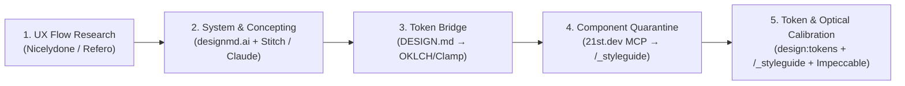

# AI-Native Visual Design, Component Sourcing & DESIGN.md Interchange

When an AI coding assistant is asked to "build a modern landing page" from a single text prompt, it almost always regresses to statistical averages: indigo-to-purple gradients, `Inter` everywhere, uniform `rounded-xl shadow-md` 3-column card rows, and thin, lifeless layouts lacking real-world UX details.

Baseline replaces one-shot prompt guesswork with a **code-first, 5-stage visual design pipeline**. You do not need to spend weeks drawing static rectangles in Figma—instead, you combine real-world UX teardowns, community `DESIGN.md` systems ([designmd.ai](https://designmd.ai/explore)), generative screen prototyping (**Google Stitch**, **Claude Design**, **OpenDesign**), open Tailwind component registries (**21st.dev**), and live in-browser optical calibration.

---

## 1. The 5-Stage Design Alchemy Pipeline



### How the Tools Fit Together (Zero Overlap)

Each optional tool in the ecosystem solves a different layer of the design problem:

| Layer | Tool / Service | What It Provides |
| :--- | :--- | :--- |
| **1. UX Flows & Anatomy** | **Nicelydone MCP** / **Refero.design** / **Kombai** | Real-world page flows, filter bars, secondary metadata, and empty states. |
| **2. Macro Design System** | **[designmd.ai](https://designmd.ai/explore)** (`designmd-mcp`) | 420+ free community `DESIGN.md` design systems (colors, font pairings, elevation, guidelines). |
| **3. Visual Screen Prototyping** | **Google Stitch** / **OpenDesign** / **Claude Design** | Generates visual screen mockups from prompts and consumes/emits `DESIGN.md` files. |
| **4. Micro-Component Blueprints** | **21st.dev MCP** (`@21st-dev/magic`) | High-craft Tailwind component structures & micro-interactions (transmuted to zero-JS Astro). |
| **5. Token & Optical Calibration** | **`npm run design:tokens` + `/_styleguide` + `impeccable`** | Automated WCAG contrast & fluid scale verification, `/_styleguide` specimen checks, and UI critique. |

---

### Step 1: Real-World UX & Flow Teardowns (`Nicelydone` / `Refero` / `Kombai`)
Before inventing sections from scratch, ground your layout in real production UX anatomy:
- **Nicelydone MCP & Refero.design:** Search real-world web and SaaS screens, onboarding flows, directories, pricing tables, and navigation shells.
- **Kombai Gallery:** Browse curated web screens structured for AI coding prompts.
- **What to extract:** Do not copy a brand's colors or logo. Extract **structural UX anatomy**:
  - What secondary metadata makes a card or table row feel credible (timestamps, category tags, status dots, hairline dividers)?
  - How does the page vary its **section pacing** (alternating dense multi-column index grids with spacious asymmetric feature spotlights)?
  - What empty, filter, or mobile disclosure states are needed?

### Step 2: Macro Design Systems (`designmd.ai`) & Visual Concepting (`audit/visual-concepts/`)
When exploring visual mood, typography, and surface contrast, combine community `DESIGN.md` systems with generative screen studies inside the isolated `audit/visual-concepts/<concept-name>/` sandbox:
- **Browse or Query [designmd.ai/explore](https://designmd.ai/explore) (`designmd-mcp`):**
  Search 420+ curated community `DESIGN.md` files by tag (`minimal`, `dark`, `warm`, `landing-page`, `accessible`, `bold`) directly from your agent—searching works without an API key, and downloading uses a free key ([setup guide](agent-documentation.md)).
- **Google Stitch + `DESIGN.md` Synergy:**
  Google Stitch natively reads and emits `DESIGN.md`. Your agent can download a starting `DESIGN.md` from `designmd.ai` (or author one from Baseline's Aesthetic Lanes), pass it to Stitch (`create_design_system_from_design_md` / `generate_screen_from_text`) to generate 2–3 visual screen concepts anchored in your **Narrative Metaphor**, and save the captures in `audit/visual-concepts/<concept-name>/`.
- **Claude Design / OpenDesign:** Rapidly prototype layout variations and typographic pairings.
- **Why the Sandbox Matters:** Never paste raw AI-generated prototype HTML directly into `src/pages/`. AI visual generators frequently output fixed-width containers (`w-[1440px]`), hardcoded copy, and flat sRGB hex codes that bypass EmDash CMS bindings. Files in `audit/visual-concepts/` are exempt from the Art Direction Gate so you can iterate freely before committing to production code.

### Step 3: The `DESIGN.md` Token Bridge & Fluid Upgrade
In the wild, you will encounter two complementary forms of `DESIGN.md`:
1. **Prose `DESIGN.md` (used by [designmd.ai](https://designmd.ai/what-is-design-md) & Google Stitch):** Pure markdown sections (`## Colors`, `## Typography`, `## Spacing`, `## Components`, `## Elevation`) that LLMs and Stitch read natively.
2. **Frontmatter-Validated `DESIGN.md` (checked by `@google/design.md@0.4.0`):** Adds normative YAML token frontmatter (`colors`, `typography`, `rounded`) above the markdown prose so deterministic CLI scripts can lint and export tokens offline.

To bridge a chosen concept into Baseline's stylesheet:
1. **Validate & Export Normative `DESIGN.md` Tokens:**
   When using YAML frontmatter with Baseline's mapping sidecar, validate offline via the lockfile-pinned `@google/design.md` CLI:
   ```sh
   npm run design:check -- --file audit/visual-concepts/neutral-interchange/DESIGN.md --mapping audit/visual-concepts/neutral-interchange/mapping.json
   ```
   Export candidate CSS custom properties for review:
   ```sh
   npm run design:export -- --file audit/visual-concepts/neutral-interchange/DESIGN.md --format css-vars
   ```
2. **Upgrade Static Tokens to Fluid Physics:**
   External `DESIGN.md` files specify static pixel sizes (`32px`) and sRGB hex codes (`#6366F1`). When merging into `src/styles/global.css`, upgrade colors into Baseline's **OKLCH gamut** and map font sizes/spacing into **mathematical fluid `clamp()` scales** (`320px` to `1280px` viewports).

> [!CAUTION]
> **CLI Binary Distinction (`@google/design.md` vs. `designmd.ai`):**
> Baseline pins `@google/design.md@0.4.0` in `package.json`, which provides the local `designmd` binary used by `npm run design:check` and `npm run design:export`. The community registry at [designmd.ai/cli](https://designmd.ai/cli) *also* names its npm CLI package `designmd`. Do **not** install `designmd` into `package.json` (which would overwrite the validator). To query `designmd.ai`, either connect **`designmd-mcp`** (`npx -y designmd-mcp`) or run `npx --package=designmd designmd search "<query>"`.

### Step 4: Component Sourcing (`21st.dev MCP`) & The Zero-JS Quarantine (`/_styleguide`)
Once your macro design tokens are set in `src/styles/global.css`, your agent can query the **21st.dev MCP** registry to fetch polished, high-craft Tailwind component blueprints (e.g., bento grids, editorial timelines, interactive accordions, subtle spotlight cards, or split-sticky sections) rather than hallucinating complex UI from scratch.

> [!IMPORTANT]
> **The Baseline Quarantine Rule:** Never drop raw external registry code directly into a public route. Every sourced component must pass through **`/_styleguide` Quarantine** using the **5-Step Transmutation Protocol**:

1. **De-Reactify to Zero-JS Astro:** Strip unnecessary React state, `framer-motion` wrappers, and client hydration (`client:*`). Convert JSX into native `.astro` markup using pure CSS transitions, `@keyframes`, native `<details>/<summary>`, or CSS `:has()` / checkbox toggles wherever possible.
2. **Map Hardcoded Palette Classes to Semantic Tokens:** Replace hardcoded Tailwind colors (`bg-zinc-900`, `text-slate-400`, `border-white/10`) with Baseline's surface-aware semantic tokens (`var(--color-surface)`, `var(--color-text)`, `var(--color-muted)`, `var(--color-border)`, and `data-surface="dark"`).
3. **Fluidize Typography & Spacing:** Replace rigid pixel utilities (`text-4xl`, `p-10`) with Baseline's fluid typographic steps (`--text-step-2`, `--text-step-3`) and structural primitives (`<Section>`, `<Container>`, `<Grid>`, `.flow`).
4. **Bind EmDash Live Edit Proxies:** Accept and forward CMS field attributes (`{...entry.edit.title}`) so the component is live-editable inside the EmDash Visual Editor (`docs/emdash-editorial-canvas.md`).
5. **Stress-Test on `/_styleguide`:** Verify narrow (`320px`/`390px`), intermediate (`768px`), and wide (`1440px`) viewports, long translated strings, missing media, keyboard focus rings, and `prefers-reduced-motion`.

#### Example: Transmuting a Raw Registry Snippet into Production Astro

````carousel
```tsx
// ❌ BEFORE: Raw React/Tailwind snippet from external registry
// Problems: Requires React runtime, hardcoded zinc/indigo hex colors,
// rigid px sizes, and static uneditable strings.
import { motion } from "framer-motion";

export function FeatureSpotlight({ title, category, description }) {
  return (
    <motion.div
      initial={{ opacity: 0, y: 12 }}
      animate={{ opacity: 1, y: 0 }}
      className="rounded-2xl bg-zinc-900 border border-zinc-800 p-8 shadow-xl"
    >
      <span className="text-xs font-mono uppercase tracking-widest text-indigo-400">
        {category}
      </span>
      <h3 className="mt-3 text-3xl font-bold text-white">{title}</h3>
      <p className="mt-4 text-base leading-relaxed text-zinc-400">{description}</p>
    </motion.div>
  );
}
```
<!-- slide -->
```astro
---
// ✅ AFTER: Transmuted Zero-JS Astro component calibrated on /_styleguide
// Benefits: Zero client JS, semantic surface/ink tokens, fluid typography,
// and live EmDash CMS visual editor bindings.
interface Props {
  title: string;
  category?: string;
  description: string;
  edit?: {
    title?: Record<string, unknown>;
    category?: Record<string, unknown>;
    description?: Record<string, unknown>;
  };
}

const { title, category, description, edit } = Astro.props;
---

<article class="feature-spotlight flow" data-surface="dark">
  {category && (
    <p class="feature-spotlight__eyebrow" {...edit?.category}>{category}</p>
  )}
  <h3 class="feature-spotlight__title" {...edit?.title}>{title}</h3>
  <p class="feature-spotlight__body" {...edit?.description}>{description}</p>
</article>

<style>
  .feature-spotlight {
    background: var(--color-surface);
    color: var(--color-text);
    border: 1px solid var(--color-border);
    border-radius: var(--radius-card);
    padding: var(--space-l);
    transition: border-color 180ms ease, transform 180ms ease;
  }
  @media (prefers-reduced-motion: no-preference) {
    .feature-spotlight:hover {
      transform: translateY(-2px);
    }
  }
  .feature-spotlight__eyebrow {
    font-family: var(--font-mono);
    font-size: var(--text-step--1);
    letter-spacing: 0.08em;
    text-transform: uppercase;
    color: var(--color-action);
  }
  .feature-spotlight__title {
    font-family: var(--font-display);
    font-size: var(--text-step-2);
    line-height: 1.15;
  }
  .feature-spotlight__body {
    font-size: var(--text-step-0);
    color: var(--color-muted);
    max-width: 62ch;
  }
</style>
```
````

### Step 5: Automated Token Calibration & Optical Critique (`design:tokens` + `Impeccable`)
Once your components are mounted on `/_styleguide` and representative routes:
1. **Parametric Scale & WCAG Contrast Audit (`npm run design:tokens`):**
   Generate or refine fluid typography/spacing scales (`--type-scale`, `--space-scale`) and OKLCH brand palettes (`--seed-accent`), verify all 10 WCAG AA contrast pairs across default and `[data-surface="dark"]` contexts, and export the Stage 4.5 calibration table (`npm run design:tokens -- --write-calibration`).
2. **Responsive & Edge-Case Inspection (`/_styleguide`):**
   Inspect typography measures, `<Container breakout>` tracks, and `<Card>` states across `390px`, `768px`, and `1440px` viewports with live Vite HMR.
3. **Bounded Visual Critique (`impeccable`):**
   Run a bounded **`impeccable`** critique pass on rendered routes to eliminate visual monotony before scaling across all routes.

*(Note: If a client happens to supply an existing Figma file, you can optionally connect the official Figma MCP server to inspect layer tokens directly, then follow Steps 3–5 above.)*

---

## 2. Specification & Token Mapping Details

Baseline pins the lockfile-pinned `@google/design.md@0.4.0` CLI (using the Windows-compatible `designmd` alias) and the alpha specification at commit `9bf8eae`.

A reference implementation with full sidecar mappings is checked into [`audit/visual-concepts/neutral-interchange/`](../audit/visual-concepts/neutral-interchange/).

### Observed Format Mappings & Schema Boundaries

External token schemas often flatten modern CSS features. Baseline's mapping sidecar (`mapping.json`) accounts for these boundaries:

| Source Token / Case | `DESIGN.md` Representation | Observed Limitation in 0.4.0 |
| :--- | :--- | :--- |
| `--color-action` (OKLCH) | `colors.primary` accepts raw OKLCH expression | `css-vars` export converts to sRGB hex; original gamut intent is lost. Retain OKLCH in source. |
| Semantic Alias | `{colors.primary}` | Export duplicates the resolved value instead of preserving the token reference. |
| Fluid scales (`clamp()`) | Retained in `mapping.json` and prose | Alpha Dimension schema cannot express `clamp()/calc()/vi`. Never flatten fluid scales into fixed px sizes. |
| Body font stack | `typography.body.fontFamily` | Lint accepts partial roles; `css-vars` exporter omits typography when `fontSize` is absent. |
| Control radius | `rounded.control` | Namespace differs from production `--radius-control`. Review before merging. |
| Surface & focus roles | Documented in sidecar prose | `data-surface="dark"` changes contextual focus ink; no independent full dark theme is inferred. |

---

## 3. Guiding Rules

- **Source Code is Authoritative:** `src/styles/global.css` and Astro component templates own production values. `DESIGN.md` and external registries act as bridges, never runtime dependencies.
- **No Direct Overwriting:** Never redirect `design:export` directly over `global.css`, and never paste un-quarantined registry components directly into `src/pages/`.
- **Graceful Degradation (Zero Lock-In):** Every external MCP (`designmd-mcp`, `21st.dev`, `Stitch`, `Nicelydone`) is 100% optional. Baseline's local verification path (`npm run design:tokens`, `npm run design:check`, and `/_styleguide`) works completely offline without paid accounts.
