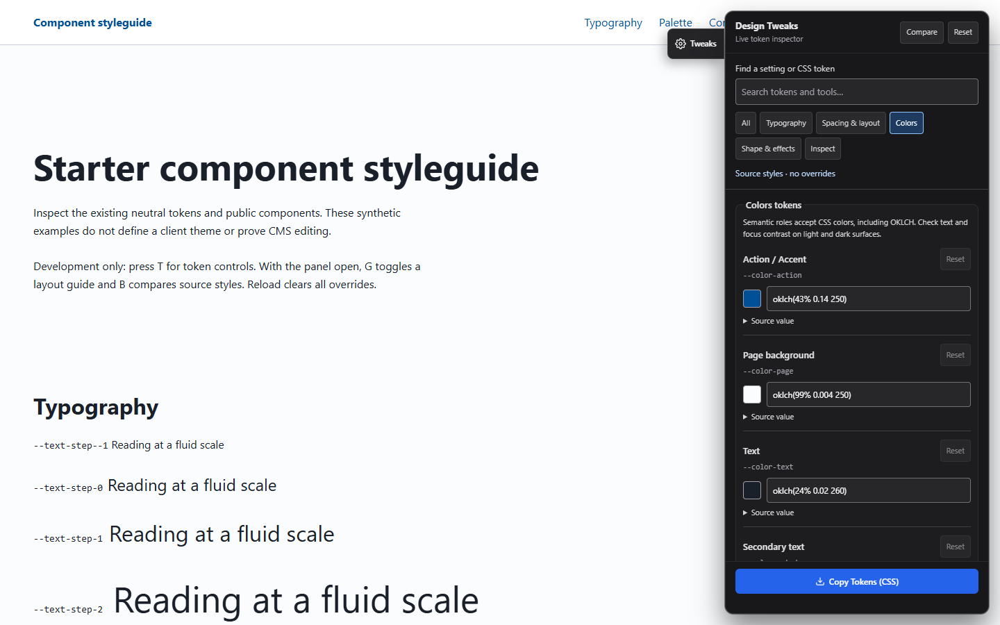

# Local visual developer tools

In `astro dev`, open TweaksBar with **T** or its tab. **B** compares source styles; **G**, **O** and **P** toggle independent diagnostic layers while the drawer is open. Escape hides the most recently activated tool before closing the drawer. Shortcuts yield to text inputs, textareas, selects, contenteditable, composition, modifiers, visible dialogs and active EmDash editing. Buttons remain available when editing mode owns keyboard shortcuts.

The drawer keeps token calibration until Reset/reload. Closing it clears the reference and active diagnostic layers. Reset restores source tokens and clears every tool. Navigation/pagehide restores original inline tokens, aborts listeners/observers/frames and releases references; page-load and persisted pageshow initialize once. Nothing is restored from persistent browser storage.

## T: design token dashboard

Use **All**, **Typography**, **Spacing & layout**, **Colors**, **Shape & effects**, or **Inspect** to narrow the drawer. Search matches setting labels, CSS variable names and tool descriptions within the selected category. A no-results message explains how to recover. All diagnostic buttons and G/O/P shortcuts remain available; filtering does not deactivate a running layer.

The catalog follows the public tokens in `src/styles/global.css`: both font families, all six fluid text sizes/pairs, all six spacing values, nine semantic colors (including focus on dark), radii, layered shadows, easing curves, reading/content/wide measures and scroll offsets. Safe content width is derived and read-only. Source values come from the loaded stylesheet, with authored defaults for unused Tailwind tokens. The catalog-coverage test fails when an authored theme token is missing, so future system additions cannot silently leave the inspector behind.

Heading scale includes both fluid display pairs. Spatial density includes container gutters and both fluid spacing pairs. An explicit token edit takes precedence over its family slider. **Reset** beside a token returns just that token to its captured source value, even while a family scale is active; the header Reset clears all calibration and diagnostic tools. Returning a field to its source value removes its override from preview/export.

Each token shows its CSS name and an expandable source value; colors include a swatch. The status distinguishes unchanged source, live override count and paused baseline comparison. Invalid CSS values retain the last valid preview, show an inline error and block export, including when filtered out. Font family controls select fonts already available to the site; they do not load fonts or verify weights. Color validity is not contrast certification.

**Copy Tokens (CSS)** exports changed values to the matching `@theme` or `:root` block. Merge them into `src/styles/global.css`, reload without overrides, and verify narrow/wide layouts, contrast and font weights. Clipboard failure exposes a selectable CSS field. The drawer uses its own fixed control styles so calibrating the site does not recolor or resize its controls.

The category, search and contextual-help organization came from research into how existing dashboard-style
settings interfaces are structured for browsing and searching settings. This is a native Baseline inspector
using Baseline token names and existing in-memory preview/export behavior; it adds no runtime dependency on
any other plugin.

## G: container grid guide

Press **G** while the TweaksBar drawer is open to toggle the diagnostic layout guide.

*The grid guide overlays the container's computed bounds, padding, and column tracks directly over your layout.*

The guide reads the selected `Container` element's computed padding, max-width bounds, and inner grid gap directly from the DOM:
- **Configurable column presets:** Switch between 12-column and 10-column diagnostic overlays to inspect content alignment.
- **Surface & RTL aware:** Adapts dynamically to viewport resizes, zoom, and right-to-left document directions without adding intrusive layout borders or horizontal overflow.
- **Zero layout interference:** The overlay is pointer-events inert and does not alter underlying layout geometry.

## O: reference overlay

Press **O** while the TweaksBar drawer is open to toggle the mockup reference overlay.

*The reference overlay controls allow adjusting opacity, X/Y pixel offsets, and document-scrolling vs fixed viewport modes.*

Choose one local PNG, JPEG or WebP through the labelled picker or drop it on the Reference overlay fieldset. V1 accepts no remote URL, SVG or other file types. Limits: 10 MiB, 32 megapixels, width ≤16000 and height ≤60000 bitmap pixels. Headers are checked before decode; damaged files, MIME mismatches and orientation/dimension inconsistencies are rejected. Re-export rotated imagery with orientation applied if its decoded dimensions differ from its header.

The reference stays in memory through revocable object URLs. Replacing, clearing, closing, Reset or teardown releases URLs, including stale asynchronous loads. Hiding O temporarily retains the selected image until one of those clearing actions. Reference loading makes no HTTP request, upload, storage write or CMS call; normal site/EmDash network activity remains independent.

Bitmap dimensions divided by **Reference capture DPR** establish CSS-pixel dimensions. Enter the capture's actual DPR (default 1). **Explicit image scale** defaults to 1 and changes display size only when selected. Viewport/DPR mismatches are reported without stretching the image. X/Y offsets use CSS pixels. Focus the labelled alignment pad for arrow-key movement (1px, Shift 10px); other controls retain their native keys.

- **Full document:** X/Y refer to the document origin; the reference moves with page scrolling.
- **Fixed viewport:** X/Y refer to the viewport; scrolling leaves the reference fixed.

The inert, pointer-transparent layer is clipped to the viewport and creates no document overflow. Opacity and alignment are visual aids, not a numerical diff or fidelity result. Token export contains only token changes, never the reference bytes, object URL or inspector metadata.

## P: EmDash ownership inspection

Press **P** while the TweaksBar drawer is open to toggle CMS ownership diagnostics.

*Visual diagnostics outline observed CMS field bindings (green), entry context (blue), and unannotated UI text (amber).*

The adapter is bounded to the installed **EmDash 1.3.0** JSON `data-emdash-ref` format: collection, id, optional field/status/hasDraft. The integration supplies the actual installed package version. A different version or unsupported shape produces an explicit unsupported result; the unit fixture exercises the installed upstream proxy implementation. Review the adapter when upgrading EmDash.

Green solid boxes mean **field annotation observed**; blue solid boxes mean **entry context**. Hover/focus page content or use the labelled annotation selector. Amber dashed boxes mean **unannotated/unknown**; dictionary text, derived content and deliberate fallbacks may correctly have no marker. An entry wrapper does not establish field ownership for all descendants. Magenta dashed boxes indicate unsupported annotations. A textual legend and selected-element details accompany the colors.

The current marker format supplies **no entry locale**. The tool says so rather than deriving it from page language. It displays known identifiers only, not content values or malformed raw JSON. Public mode commonly emits no annotations; that is not an error or a missing-field verdict. Rendering is bounded to the first 250 annotations and visible boxes; selected metadata updates when the element or marker changes.

Inspection is read-only: no CMS requests, registration, field repair, content mutation or private-value export. An annotation does not prove a field is registered, populated, editable or saveable. Actual CMS editing and save/reload certification remain separate. Inspector layers never intercept pointer events or add writable identities to source specimens.

## Verification and production isolation

`npm run test:dev-hud` runs a local-only pinned Windows Chromium suite on a disposable dev app and fresh seed. It verifies file/drop/mismatch/scrolling/URL cleanup, unsupported inputs, real EmDash annotations, unknown UI text, keyboard guards, catalog search/category filters, invalid-value recovery, per-token and global reset, preview/export parity, grid geometry/RTL and lifecycle reinitialization. It shares the visual renderer contract and rejects CI. No browser job or mandatory hook is added to Actions.

Run `node --test tests/*.test.mjs`, `npm run typecheck`, `npm run build`, `npm run check:dev-tools` and `npm run test:visual` as appropriate for tool changes. `check:dev-tools` verifies normal versus fixture HTTP behavior and scans emitted client JS/CSS for functional G/O/P code. The component's `import.meta.env.DEV` guard removes imports/listeners/adapter/reference logic from production. Normally built styleguide GET/HEAD remains 404; fixture output is separate and rejected by the release guard. Harmless empty script stubs are allowed. Client visual comparison uses unchanged source goldens with no HUD layers or token overrides.
