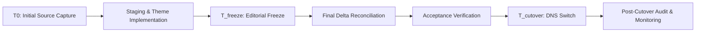

# Migration Cutover: Content Freeze, Delta Reconciliation and Rollback

This runbook defines the operational procedure for transitioning a production site from WordPress to EmDash. It covers the pre-cutover content freeze, snapshot-driven delta reconciliation, DNS switchover, and rollback safety.

Before any production schema/content mutation, record a restorable database recovery point plus matching media/key receipts. Use [Cloudflare recovery](cloudflare-backup-restore.md) for D1/R2 and the full encryption-key list; site export does not protect authentication or plugin state. Missing recovery evidence blocks migration. Never reset production to repair import/login.

## 1. The Migration Window and Content Freeze

A migration is not instantaneous. Between the initial source capture (`T0`) and DNS cutover (`T_cutover`), changes may occur on both the legacy WordPress site and the target EmDash preview environment.



### Freeze Protocol

1. **Establish the Editing Freeze (`T_freeze`):**
   - Agree on an explicit editorial freeze window with client stakeholders (typically 24–48 hours before cutover).
   - Announce the freeze to all WordPress users: no new posts, pages, menu edits, or media uploads during this window.
   - Restrict WordPress editing roles if possible (e.g. downgrade editors to subscribers or install a temporary maintenance banner).
2. **Access Control during the Migration Window:**
   - Clearly designate who is authorized to make changes to the EmDash target environment.
   - Do not allow client editors to make unsynchronized edits in EmDash until cutover is formally accepted.

---

## 2. Delta Reconciliation Procedure

Re-running the EmDash importer is **not a synchronization mechanism**. As proved in the [Importer Fidelity Rehearsal](importer-fidelity-matrix.md):
- Retried imports skip already-imported entries (`skipExisting`).
- Source deletions on WordPress leave target entries intact in EmDash.
- Changed slugs on WordPress create duplicate entries in EmDash.

Delta changes must be identified and reconciled deliberately using export snapshots.

### Step-by-Step Delta Reconciliation

1. **Capture Snapshots:**
   - Retrieve the initial source export snapshot (`snapshot-T0.xml` or JSON).
   - Generate a fresh, final export snapshot from WordPress at `T_freeze` (`snapshot-Tfinal.xml` or JSON).
2. **Compute the Delta:**
   - Compare `snapshot-T0` against `snapshot-Tfinal` using a diff or inventory script:
     - **New Entries:** Posts or pages published between `T0` and `T_freeze`.
     - **Modified Entries:** Existing entries whose `post_modified` timestamp changed.
     - **Deleted Entries:** Entries present in `T0` but missing from `Tfinal`.
     - **Slug / Permalink Shifts:** Entries whose slug or hierarchy was edited.
3. **Reconcile Into EmDash:**
   - **New Entries:** Run a targeted import or manually author the entries in EmDash with matching slugs and locales.
   - **Modified Entries:** Inspect the specific fields changed. Apply modifications directly in EmDash or through supported content APIs. Do not overwrite target-side improvements (such as refined typography or newly formatted Portable Text blocks) with raw WordPress HTML.
   - **Deleted Entries:** Explicitly delete the corresponding entries in EmDash, or update the URL manifest to mark them as `removed` (serving 410 Gone or 301 redirects to relevant parent categories).
   - **Slug Shifts:** Ensure the old URL is registered in EmDash's redirect manager (301 redirect to the new URL) and update the acceptance manifest accordingly.
4. **Re-run Full Migration Acceptance:**
   ```sh
   npm run migration:verify -- --scope full --manifest audit/url-inventory.json
   ```
All required checks must pass (exit `0`) before proceeding to DNS switchover.
5. **Acquire Pre-Cutover Backup Snapshot:** For Node.js + SQLite deployments, acquire a verified SQLite backup via `.backup` or `VACUUM INTO` and archive current media and configuration per [Node.js Backup & Recovery](node-backup-restore.md). For Cloudflare, enforce the bookmark/media/key gate and setup-status, scheduler and cache-parity acceptance in [edge lifecycle](edge-cache-lifecycle.md).

---

## 3. DNS Cutover Execution

### Pre-Cutover Preparation (T - 48 Hours)
- **Lower TTL:** Reduce DNS Time-To-Live (TTL) on the domain's `A` and `CNAME` records to 300 seconds (5 minutes). This ensures rapid propagation and immediate rollback capability.
- **SSL Pre-provisioning:** Ensure SSL/TLS certificates for the custom domain are active or ready on the new host (e.g. Cloudflare, Node reverse proxy with Let's Encrypt).
- **Email DNS Protection:** Verify that MX, SPF, DKIM, and DMARC records remain completely untouched. Follow the [Support Boundaries](support-boundaries.md) and DNS safety guidance to prevent email disruption.

### Switchover Day
1. Update DNS `A` / `CNAME` records to point to the new production server.
2. Monitor DNS propagation using global lookup tools.
3. Verify public response:
   - Check SSL certificate validity.
   - Verify that requests to `https://domain.com/` return HTTP 200 from the new server.
   - Run a live verification pass against production:
     ```sh
     npm run migration:verify -- --manifest audit/url-inventory.json --scope url
     ```

---

## 4. Post-Cutover Reconciliation & Rollback

### Handling Form Submissions in Flight
During DNS propagation (typically 2–6 hours), visitors may still hit the old WordPress server cached by local ISPs.
- Keep the old WordPress database running read-only or with active database logging.
- Monitor form submission tables (CF7, Gravity Forms, WPForms) or transactional email logs for submissions created during propagation.
- Transcribe any missed customer inquiries into the client's CRM or notify the client directly.
- Once traffic to WordPress drops to zero for 48 hours, decommission the WordPress instance.

### Rollback Plan
If critical issues occur immediately after cutover (e.g. catastrophic application crash, database corruption, critical form failure), execute the rollback protocol:

1. **Rollback Trigger Criteria:**
   - Core transactional or lead-generation workflows are completely broken.
   - Data loss or unresolvable server failure occurs during peak business hours.
2. **Rollback Execution:**
   - Immediately revert DNS `A` / `CNAME` records back to the original WordPress hosting IP.
   - Because TTL was set to 300 seconds, traffic will divert back to WordPress within minutes.
3. **Post-Rollback Audit:**
   - Identify any submissions or orders placed on the new site during the cutover window and export them.
   - Perform a root-cause analysis in an isolated environment before rescheduling cutover.
