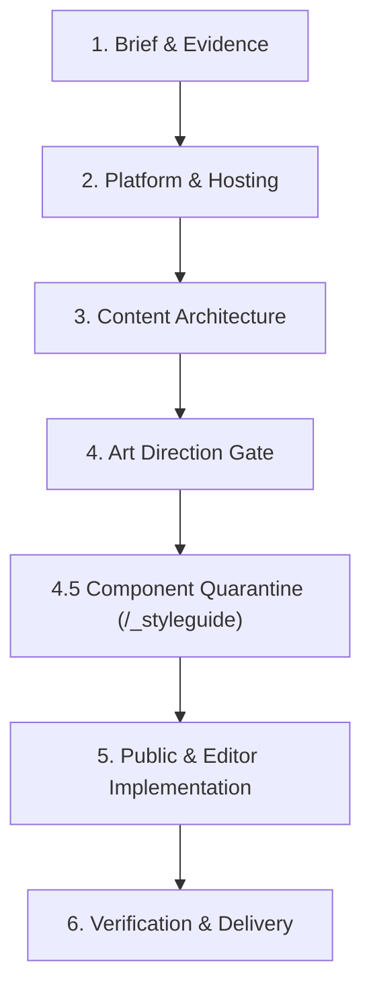

# Site Delivery Workflow

Baseline uses a structured **6-stage delivery workflow** designed to keep developers and AI coding assistants disciplined. 

When building client websites with AI coding assistants, the most common failure mode is **"one-shot prompt chaos"**: asking the agent to generate discovery, content models, templates, and styles all at once. This leads to hallucinated schemas, generic styling, broken responsive layouts, and hardcoded UI copy that clients cannot edit.

By breaking work into explicit sequential stages—each gated by review and automated checks—you get agency-grade results every time.

---

## Stage 1: Brief & Evidence Discovery

Never start by writing code or prompting an assistant to "make a homepage." Begin by gathering ground-truth evidence:
- **Client Brief & Goals:** Target audience, business objectives, brand voice, and language requirements.
- **Visual Evidence:** Brand assets (SVG logos, brand guidelines, color palettes, photography) and existing site screenshots (desktop and mobile).
- **Functional Requirements:** Multilingual needs, forms, galleries, third-party embeds, or custom integrations.
- **Deliverables:** Record findings in project notes before opening templates.

---

## Stage 2: Platform & Hosting Decisions

Establish your runtime and hosting boundaries before modeling content:
- **Default Profile:** Node.js + SQLite + local media storage. Zero cloud dependencies, fast local development, perfectly reproducible.
- **Cloudflare Profile (Optional):** Cloudflare Workers + D1 (SQLite) + R2 (media storage).
  - *Hard Limit Awareness:* Cloudflare D1 enforces a [100-column table maximum](https://developers.cloudflare.com/d1/platform/limits/). Baseline enforces a stricter **50-column physical schema budget** (`npm run check:schema-budget`) to ensure long-term stability.
  - *Session Storage:* Multi-instance serverless workers require persistent storage for form recovery (`docs/forms-adoption.md`).
- **Guide:** [Hosting Setup](.agents/skills/emdash-site-setup/SKILL.md).

---

## Stage 3: Content Architecture & Candidate Discovery

Model your editorial data structure *before* creating page templates:
- **WordPress Migrations:** If migrating from an existing site, do not blindly replicate messy postmeta tables. Run the [WordPress Content Modeling & Candidate Register](wordpress-content-modeling.md) workflow.
- **The Content Candidate Register:** Hunt for repeated operational entities trapped in page builder blocks or ACF repeaters (e.g., rosters, schedules, venues, sponsors) and promote them to first-class EmDash collections.
- **Relational Integrity:** Model 1:N relations and master data lookups rather than bloating single collection rows.
- **Multilingual Architecture:** Enforce EmDash's native row-per-locale model (`docs/internationalization.md`). Never create language-suffixed columns (e.g. `title_en`).
- **Slugs vs. Labels:** Keep database slugs in clean ASCII kebab-case (`training_sessions`) while authoring admin display labels in the client's working language.

---

## Stage 4: Art Direction & Aesthetic Gate

Before writing a single line of site-specific CSS or template HTML, establish a distinct visual identity to prevent default "generic AI landing page" output:
- **Select an Aesthetic Lane:** Choose a lane from `.agents/skills/site-art-direction/references/aesthetic-lanes.md` (e.g., *Minimal Editorial*, *Industrial Technical*, *Warm Heritage*, *Brutalist Precision*, *Kinetic Modern*).
- **Define Token Physics:** Set typography pairings, canvas ground, action/accent contrast, border philosophy, and spatial density.
- **Declare Anti-Patterns:** Write 2–3 explicit bans (e.g. *"No floating rounded cards; no decorative icon pills; no purple gradients"*).
- **Save the Art Direction Record:** Write the `## Art Direction Record` block in `AGENTS.md`.
- **The Gate:** Run `npm run check:art-direction -- --require-record`. If this record is absent, CI and build preflights will fail.
- **Guide:** [Art Direction Workflow](art-direction-workflow.md).

---

## Stage 4.5: Component Quarantine (`/_styleguide`)

Do not attempt to assemble twenty full pages at once. Calibrate your reusable components in isolation first:
- Open **`/_styleguide`** in your browser.
- **Calibrate Scalings & Tokens:** Press **`T`** to open TweaksBar. Adjust typography scales, line-heights, and spatial density live on the page. Press **`B`** to A/B compare against source CSS, then copy and merge the changed tokens into `src/styles/global.css`.
- **Align Mockups:** Press **`O`** to drop your Figma mockup or reference screenshot onto the overlay and align spacing pixel-for-pixel.
- **Stress-Test Edge Cases:** Test components against extreme conditions: long translated headings, missing images, uneven grid counts, right-to-left (RTL) text, and high-contrast zoom.
- **Production Guard:** `/_styleguide` automatically returns **404** in production builds.
- **Guide:** [Component Quarantine & Styleguide Fixtures](styleguide-fixtures.md).

---

## Stage 5: Representative Public & Editor Implementation

Now assemble your public routes and wire up EmDash CMS editing:
- **Compose with Primitives:** Build layouts using `<Section>`, `<Container>`, and `<Grid>` primitives (`docs/design-framework.md`).
- **Bind Editorial Canvas Proxies:** Pass page identity to `Base.astro` and spread field proxies (`{...entry.edit.title}`) onto the rendered elements so clients can visually edit content in the CMS (`docs/emdash-editorial-canvas.md`).
- **Media Optimization:** Use native Astro image delivery for photographic assets (`docs/image-delivery.md`) and run `npm run media:organize` to tidy WordPress media imports into structured folders.
- **Zero-JS by Default:** Use pure CSS interactive primitives like `LogoTicker` and justified `PhotoGallery` (`docs/reusable-public-patterns.md`).

---

## Stage 6: Verification & Delivery

Run deterministic local checks to verify the build before client handoff or deployment:
- `npm run check:schema-budget`: Verify no collection exceeds the 50-column physical limit.
- `npm run typecheck`: Full Astro check, TypeScript diagnostics, and schema preflight.
- `node --test tests/*.test.mjs`: Run unit and tooling test suites.
- `npm run test:visual`: Compare local Windows screenshots against reviewed baselines across mobile, tablet, and desktop viewports (`docs/visual-regression.md`).
- `npm run check:dev-tools`: Confirm the Dev HUD and `/_styleguide` are completely stripped from the production build.
- **Client Verification:** Log in to `/_emdash/admin`, test editing live content, publish drafts, and verify updates on the public site.
