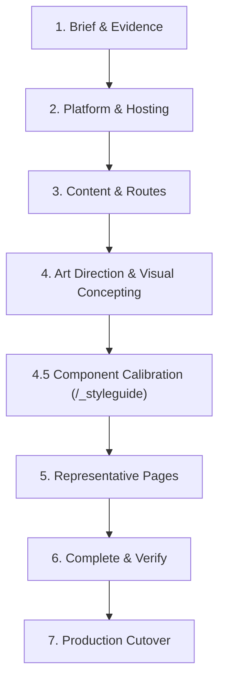

# Site Delivery Workflow

Baseline uses a structured **7-stage delivery workflow** designed to keep developers and AI coding assistants disciplined.

When building client websites with AI coding assistants, the most common failure mode is **"one-shot prompt chaos"**: asking the agent to generate discovery, content models, templates, and styles all at once. This leads to hallucinated schemas, generic styling, broken responsive layouts, and hardcoded UI copy that clients cannot edit.

The stages separate discovery, modeling, design and implementation, with written handoffs and profile-appropriate checks for art direction, tokens, script syntax, tests and Astro types. These checks support review; rendered behavior, migration fidelity and host/provider acceptance still need site-specific evidence. See [Capability and Support Boundaries](support-boundaries.md) and the **[AI Developer Prompt Library](prompt-library.md)**.

**This page is an overview for people.** The instructions an agent follows, including every stage's full steps and its gate, live in the [`new-site-workflow` skill](../.agents/skills/new-site-workflow/SKILL.md) and its stage references, linked per stage below. When this page and the skill disagree, the skill governs; this page does not repeat stage details so that it cannot drift from them.

## Profile and track

Platform Profile (`static`, `static-sveltia`, `emdash`) selects content, editing and runtime; Standard or Express selects delivery sequencing. They are independent choices. Read [Platform Profiles](platform-profiles.md) before choosing a track. SQL budget, live-editor, registry and database deployment steps apply only to EmDash.

| Track | Best for | Handoffs and decisions |
| --- | --- | --- |
| **Standard (7 stages)** | Migrations, more than one locale, more than six route archetypes or three collections, editor roles, cross-collection relationships, integrations, authentication or payments | A handoff per stage; a question only when a consequential decision is unresolved |
| **Express (up to 3 checkpoints)** | Smaller greenfield sites (`<= 6` route archetypes, `<= 3` collections, single locale) | **A** (Stages 1–3), **B** (Stages 4–4.5), **C** (Stages 5–6) |

Express runs the same stages, specialists and CLI gates as Standard; it only consolidates open decisions. Both tracks continue authorized work without mandatory handoff stops and honor an explicit request to stop at a stage or review before continuing. A saved Art Direction Record or passing gate establishes neither user approval nor visual acceptance. Local preparation, deployment, CMS content transfer and DNS changes have distinct scopes and evidence.

## The stages

| Stage | What it settles | Leave the stage when | Full instructions |
| --- | --- | --- | --- |
| 1 Brief and evidence | Audience, offer, purpose, evidence and content gaps; a content-candidate register for migrations | The brief, strategic synthesis and evidence inventory exist | [Brief, platform and content](../.agents/skills/new-site-workflow/references/brief-platform-content.md), [discovery and content](../.agents/skills/new-site-workflow/references/discovery-and-content.md) |
| 2 Platform and hosting | Profile, runtime, hosting, localization model and plugin sandbox | Those decisions are known or explicitly deferred | [Brief, platform and content](../.agents/skills/new-site-workflow/references/brief-platform-content.md) |
| 3 Content and routes | Collections or file schemas, route archetypes, editorial ownership, wayfinding and the site-search decision | Every page archetype and content candidate has a source, target, method, placement and owner | [Brief, platform and content](../.agents/skills/new-site-workflow/references/brief-platform-content.md) |
| 4 Art direction | Judged references, the site's world taken from the client's own things, two or three compared directions with one selected, and the Art Direction Record | The references are saved in `audit/references/references.md`, the record with its World and Decisions is in `AGENTS.md`, and `npm run check:art-direction -- --require-record --require-references` passes | [Art direction and calibration](../.agents/skills/new-site-workflow/references/art-direction-and-calibration.md), [art direction workflow](art-direction-workflow.md) |
| 4.5 Calibration | Tokens and primitives proven on `/_styleguide` | `audit/component-calibration.md` names the patterns ready for pages | [Art direction and calibration](../.agents/skills/new-site-workflow/references/art-direction-and-calibration.md) |
| 5 Representative pages | The shell and one page per archetype with real content, each raised to its references and then critiqued | Those pages work at mobile, intermediate and wide viewports, each has its comparison sheet with five additions built (`check:art-direction -- --require-comparison`), its look (`design:look`) and a saved critique | [Build, verify and launch](../.agents/skills/new-site-workflow/references/build-verify-launch.md), [Impeccable passes](../.agents/skills/new-site-workflow/references/impeccable-passes.md) |
| 6 Complete and verify | Every route and state, automated checks, browser and editor acceptance | `check:quality` and `audit:ui` pass on the built preview or each finding is recorded, `audit:composition` has no floor finding, and the checks actually run are reported | [Build, verify and launch](../.agents/skills/new-site-workflow/references/build-verify-launch.md) |
| 7 Cutover | Deployment, domain, login, mail and forms, recovery, and go-live | Only the checks actually observed are reported as done | [Build, verify and launch](../.agents/skills/new-site-workflow/references/build-verify-launch.md), [Node launch](../.agents/skills/new-site-workflow/references/node-launch.md), [production deployment](production-deployment.md) |

## One session or two

One agent can run every stage. When you have a more capable model and a cheaper one, the work can be split: the capable model does Stages 1 to 4.5 and the start of Stage 5 (the shell, the home page's first screen with its working feature, and two sections), writes `audit/blueprint.md`, and stops. A second session, with any model in any coding assistant, builds the remaining sections and pages from that blueprint and runs Stages 5 and 6. The two sessions share the site folder and nothing else, so the split does not depend on a tool. In Baseline's trials this produced better-marked pages than the cheaper model designing alone, because the direction, the design system and the first screen decide most of how a site looks. The steps are in [start and build-out](../.agents/skills/new-site-workflow/references/start-and-build-out.md); the two prompts are in the [README](../README.md#start-with-your-best-model) and the [prompt library](prompt-library.md#a-start-by-your-best-model-the-build-out-by-another).

Scoped maintenance (a field, a component, spacing, a route) does not replay the stages: it starts at the earliest affected stage and follows [site maintenance](../.agents/skills/new-site-workflow/references/site-maintenance.md). Decisions, questions, audits and release scope follow [decisions and release](../.agents/skills/new-site-workflow/references/decisions-and-release.md).

## Where the related guides are

- **Context and records:** [project context](project-context.md) defines where the brief, the Art Direction Record and progress notes live, without adding mandatory files.
- **Design:** [design framework](design-framework.md), [native composition](native-composition.md), [visual regression](visual-regression.md).
- **Migration:** [WordPress migration](wordpress-migration.md), [migration acceptance](migration-acceptance.md), [migration cutover](migration-cutover.md).
- **Verification:** [commands](commands.md), [HTML integrity](html-integrity.md), [page performance](page-performance.md).
- **Launch and operation:** [production deployment](production-deployment.md), [Node backup and recovery](node-backup-restore.md), [Cloudflare backup and restore](cloudflare-backup-restore.md), [editor handoff](editor-handoff.md), [site registry](site-registry.md).
- **Updates:** [staged Baseline updates](baseline-updates.md) for generated static sites and existing EmDash sites.
