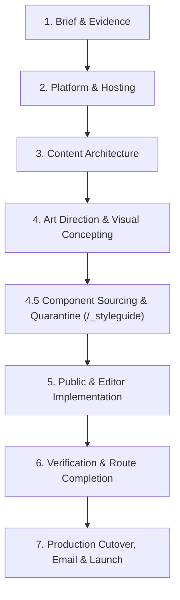

# Site Delivery Workflow

Baseline uses a structured **7-stage delivery workflow** designed to keep developers and AI coding assistants disciplined. 

When building client websites with AI coding assistants, the most common failure mode is **"one-shot prompt chaos"**: asking the agent to generate discovery, content models, templates, and styles all at once. This leads to hallucinated schemas, generic styling, broken responsive layouts, and hardcoded UI copy that clients cannot edit.

By breaking work into explicit sequential stages—each gated by review and automated checks—you get agency-grade results every time. For copy-pasteable prompts to trigger each stage with any agent, see the **[AI Developer Prompt Library](prompt-library.md)**.

---

## Stage 1: Brief & Evidence Discovery

Never start by writing code or prompting an assistant to "make a homepage." Begin by gathering ground-truth evidence:
- **Client Brief & Goals:** Target audience, business objectives, brand voice, and language requirements.
- **Visual Evidence:** Brand assets (SVG logos, brand guidelines, color palettes, photography) and existing site screenshots (desktop and mobile).
- **UX Flow Teardowns (Optional):** For complex user flows (filterable directories, registration journeys, schedules, or pricing models), inspect real-world production patterns using **Nicelydone MCP**, **Refero.design**, or **Kombai Gallery** to capture authentic UX anatomy and edge states.
- **Functional Requirements:** Multilingual needs, forms, galleries, third-party embeds, or custom integrations.
- **Deliverables:** Record findings in project notes before opening templates.

---

## Stage 2: Platform, Hosting & Plugin Decisions

Establish your runtime, hosting boundaries, and plugin needs before modeling content:
- **Default Profile:** Node.js + SQLite + local media storage. Zero cloud dependencies, fast local development, perfectly reproducible.
- **Cloudflare Profile (Optional):** Cloudflare Workers + D1 (SQLite) + R2 (media storage).
  - *Hard Limit Awareness:* Cloudflare D1 enforces a [100-column table maximum](https://developers.cloudflare.com/d1/platform/limits/). Baseline enforces a stricter **50-column physical schema budget** (`npm run check:schema-budget`) to ensure long-term stability.
  - *Session Storage:* Multi-instance serverless workers require persistent storage for form recovery ([Forms & Verification](forms-adoption.md)).
- **Curated Registry Plugins Evaluation:** Before writing custom backend code or complex relational schemas, check the official [EmDash Plugin Registry](https://plugins.emdashcms.com/) for secure, sandboxed plugins:
  - **Event Management & Ticketing:** [`@vermeulen.solutions/eventual`](https://plugins.emdashcms.com/plugins/@vermeulen.solutions/eventual) provides turnkey event schedules, session agendas, speaker profiles, and calendar exports.
  - **Translation Dashboards:** [`@swiss.ky/linguadash`](https://plugins.emdashcms.com/plugins/@swiss.ky/linguadash) provides side-by-side editing and AI translation drafting.
  - *Sandbox Runner Setup:* If using registry plugins, configure the sandbox runner (`workerd` on Node or `LOADER` on Cloudflare Workers Paid) in Stage 2 before installing the plugin.
- **Guides:** [Hosting Setup](../.agents/skills/emdash-site-setup/SKILL.md) · [Production Deployment & Cloudflare Cutover](production-deployment.md).

---

## Stage 3: Content Architecture & Candidate Discovery

Model your editorial data structure *before* creating page templates:
- **WordPress Migrations:** If migrating from an existing site, do not blindly replicate messy postmeta tables. Run the [WordPress Content Modeling & Candidate Register](wordpress-content-modeling.md) workflow.
- **The Content Candidate Register:** Hunt for repeated operational entities trapped in page builder blocks or ACF repeaters (e.g., rosters, schedules, venues, sponsors) and promote them to first-class EmDash collections.
- **Relational Integrity:** Model 1:N relations and master data lookups rather than bloating single collection rows.
- **Container & Breakout Planning:** Identify which page archetypes use standard single-measure sections (`<Container width="reading|content|wide">`) versus long-form editorial articles and case studies that interleave reading prose with wider figures, galleries, or callouts (`<Container breakout>` / `.content-grid`).
- **Multilingual Architecture:** Enforce EmDash's native row-per-locale model ([Internationalization](internationalization.md)). Never create language-suffixed columns (e.g. `title_en`).
- **Slugs vs. Labels:** Keep database slugs in clean ASCII kebab-case (`training_sessions`) while authoring admin display labels in the client's working language.

---

## Stage 4: Art Direction, Visual Concepting & The Design Gate

Before writing a single line of site-specific CSS or template HTML, establish a distinct visual identity to prevent default "generic AI landing page" output:
- **The Stage 4 Capability Prompt:** Your agent will briefly present four creative options—skip in one second to stay purely in-browser, or leverage connected MCP superpowers ([AI Agent & Harness Configuration](agent-documentation.md)):
  1. *Code-First In-Browser (Default):* Curated Aesthetic Lanes + live Dev HUD token tuning (`/_styleguide`).
  2. *UX Anatomy Research:* **Nicelydone MCP** / **Refero.design** flow teardowns.
  3. *Community `DESIGN.md` Systems & Visual Concepting:* **[designmd.ai](https://designmd.ai/explore)** (`designmd-mcp`) + **Google Stitch**, **OpenDesign**, or **Claude Design** screen studies in `audit/visual-concepts/` bridged via `@google/design.md`.
  4. *Component Sourcing:* **21st.dev MCP** Tailwind component blueprints transmuted in Stage 4.5.
- **Select an Aesthetic Lane:** Choose a lane from [Aesthetic Lanes](../.agents/skills/site-art-direction/references/aesthetic-lanes.md) (*Technical Systems*, *Product-Led Minimalism*, *Editorial Paper*, *Luminous Futurism*, or *Custom / existing brand*).
- **Define Token Physics & Pacing Variance:** Set typography pairings, canvas ground, action/accent contrast, border philosophy, spatial density, and a **Section Rhythm Map** (so consecutive sections never repeat the same layout).
- **Declare Anti-Patterns:** Write 2–3 explicit semicolon-separated bans (e.g. *"No floating rounded cards; no decorative icon pills; no purple gradients"*).
- **Save & Verify the Gate:** Write the `## Art Direction Record` block in `AGENTS.md` and run `npm run check:art-direction -- --require-record`.
- **Guides:** [Art Direction Workflow](art-direction-workflow.md) · [AI-Native Visual Design & DESIGN.md Interchange](design-interchange.md).

---

## Stage 4.5: Component Sourcing & Quarantine (`/_styleguide`)

Do not attempt to assemble twenty full pages at once. Source and calibrate your reusable components in isolation first:
- **Source High-Craft Patterns (Optional `21st.dev MCP`):** Fetch modern Tailwind component blueprints (bento grids, timelines, disclosures, spotlight cards) and transmute them through Baseline's **5-Step Quarantine Protocol**:
  1. Strip React/Framer Motion runtime down to **zero-JS `.astro` markup**.
  2. Replace hardcoded Tailwind palette classes (`bg-zinc-900`) with **semantic tokens** (`var(--color-surface)`).
  3. Upgrade fixed pixel utilities to **fluid typographic steps** (`--text-step-*`, `--text-step-3-to-1`) and `<Section>` / `<Container>` / `<Container breakout>` / `<Grid>`.
  4. Wire **EmDash CMS live edit proxies** (`{...entry.edit.title}`).
  5. Stress-test on `/_styleguide`.
- **Calibrate Scalings & Tokens (`T` / `B`):** Open **`/_styleguide`**, press **`T`** to adjust typography scales, line-heights, and spatial density live in the browser, press **`B`** to A/B compare against source CSS, and copy tokens into `src/styles/global.css`.
- **Align Mockups (`O`):** Press **`O`** to drop your Stitch/Claude concept screenshot onto the Reference Overlay and align spacing optically.
- **Stress-Test Edge Cases:** Test long translated headings, missing images, uneven grid counts, `<Card>` `.clickable-parent`/`.focus-parent` keyboard outlines and concentric radii, `.content-grid` editorial breakouts, RTL text, and `prefers-reduced-motion`.
- **Production Guard:** `/_styleguide` automatically returns **404** in production builds.
- **Guides:** [Component Quarantine & Styleguide Fixtures](styleguide-fixtures.md) · [AI-Native Visual Design & DESIGN.md Interchange](design-interchange.md).

---

## Stage 5: Representative Public & Editor Implementation

Now assemble your public routes and wire up EmDash CMS editing:
- **Compose with Primitives:** Build layouts using `<Section>`, `<Container>` (or `<Container breakout>` / `.content-grid` for editorial articles with wide callouts/media), `<Grid>`, and `<Card>` primitives ([Design Framework](design-framework.md)).
- **Bind Editorial Canvas Proxies:** Pass page identity to `Base.astro` and spread field proxies (`{...entry.edit.title}`) onto the rendered elements so clients can visually edit content in the CMS ([Editorial Canvas](emdash-editorial-canvas.md)).
- **Media Optimization:** Use native Astro image delivery for photographic assets ([Image Delivery](image-delivery.md)) and run `npm run media:migrate-wp` to normalize and ingest WordPress media imports via an auditable manifest.
- **Zero-JS by Default:** Use pure CSS interactive primitives like `LogoTicker` and justified `PhotoGallery` ([Reusable Patterns](reusable-public-patterns.md)).

---

## Stage 6: Verification & Route Completion

Run deterministic local checks to verify the build before client handoff or deployment:
- `npm run check:schema-budget`: Verify no collection exceeds the 50-column physical limit.
- `npm run typecheck`: Full Astro check, TypeScript diagnostics, and schema preflight.
- `node --test tests/*.test.mjs`: Run unit and tooling test suites.
- `npm run test:visual`: Compare local Windows screenshots against reviewed baselines across mobile, tablet, and desktop viewports ([Visual Regression](visual-regression.md)).
- `npm run check:dev-tools`: Confirm the Dev HUD and `/_styleguide` are completely stripped from the production build.
- **Visual Critique & Polish (Optional):** Use the bundled `impeccable` skill for an automated UI critique pass on rendered pages before final signoff.
- **Client Verification:** Log in to `/_emdash/admin`, test editing live content, publish drafts, and verify updates on the public site.
- **Site Registration:** Run `npm run site:register` to register the site metadata ([Site Registry](site-registry.md)).

---

## Stage 7: Production Cutover, Email & Launch

Take the verified site live on its production custom domain:
- **Node.js Target:** Generate production environment variables, configure reverse proxy (Nginx, Caddy with automatic TLS), and set up process supervision (Docker, systemd).
- **Cloudflare Target (`emdash-production-cutover`):** Connect custom production domain via Cloudflare Wrangler, issue TLS certificates, and configure apex/www canonical redirects.
- **Corporate Mail DNS Preservation:** Protect existing client email (Google Workspace / Microsoft 365) by auditing MX, SPF, DKIM, and DMARC records before modifying DNS.
- **Admin Authentication Origin:** Verify admin passkey/email login on the live production domain origin.
- **Guides:** [Production Deployment & Cloudflare Cutover](production-deployment.md) · [Hosting Setup](../.agents/skills/emdash-site-setup/SKILL.md).
