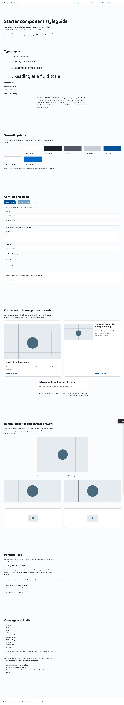

# Styleguide build profiles

`/_styleguide` explicitly injects the underscore page through the starter integration. It composes production modules with versioned synthetic fixtures from `src/dev/styleguide-fixtures.ts`; it queries no collections and submits no forms. No fake edit identities are attached. Separate real disposable CMS entries are needed for ownership/save/reload checks.

*The living styleguide (`/_styleguide`) renders all components, typographic scales, and stress states in isolation before page assembly. In production builds, this entire route automatically returns 404.*

- `npm run dev`: live component and token specimens via Vite HMR.
- `npm run fixtures:build`: explicit build-time `ASTRO_TEST_FIXTURES=1`, separate `dist-fixtures/` and `.astro-fixtures/`. `npm run fixtures:serve` binds 127.0.0.1:4349 (PORT can change). Use a disposable project/database for capture work; building code does not clone the CMS.
- `npm run build`: normal `dist/`, fixture flag defaults off. Postbuild requires `.starter-build.json` with release/deployable profile. GET/HEAD specimens return 404 even if runtime flags, query parameters or cookies request fixtures.
- `npm run check:release-artifact -- <directory>`: rejects fixture/unknown/missing profiles. Normal npm start also checks. Any future deployment job must check the exact artifact it uploads and build a clean normal release; never promote dist-fixtures. This is a packaging safeguard, not authentication or protection against someone deliberately bypassing scripts/editing metadata.
- `npm run check:dev-tools`: copies source into a temporary isolated app, initializes its fresh CMS through dev setup, verifies dev and built fixtures/assets, rejects the fixture profile for release, then builds a clean release and verifies actual HTTP 404 and public route health. Working DB/media/env files are not copied. `-- --inspect` holds that disposable fixture server for manual browser checks; Ctrl+C cleans it up.

Fixture version 2 covers actual Container/Section/Grid/Card variants, controls, semantic tokens, PT lists/quotes/links/marks/code/tables, image/gallery/partner states and LogoTicker motion/static/RTL/empty cases. All three authored geometric SVGs are local, with native dimensions; no client branding or third-party assets. Gallery/code internal scrolling is intentional. CMSPartnersPanel and actual table editor-placeholder/save checks remain explicitly deferred, as do external executable/network embeds. Unsupported design variants are listed rather than fabricated.

LogoTicker adds no script or hydration. Its trusted Astro slot contains only ID-free noninteractive li children; duplicate artwork is aria-hidden/inert. Do not put raw HTML, SVG IDs, links, forms, scripts/islands or CMS edit proxies in the slot. The checkbox toggles motion persistently without JS; hover/focus pauses, reduced motion and print show the complete first list. Test native checkbox keyboard/touch, RTL seam, short/wide tracks and static wrapping. Existing styleguide image/gallery modules may ship their own enhancement scripts; that does not change the ticker's contract.

A pinned Linux screenshot container harness is planned as an upcoming addition. Browser geometry checks do not establish full accessibility conformance, and HTTP checks do not establish visual fidelity or CMS editing.
